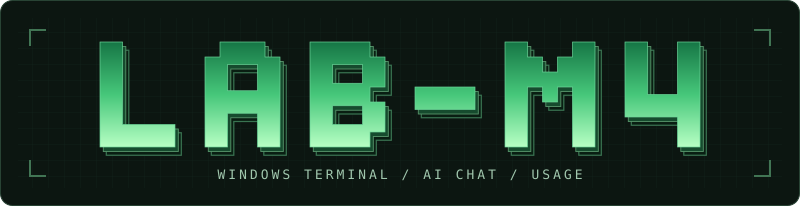

<p align="center">
  
</p>

<h1 align="center">Lab-M4</h1>

<p align="center">Windows terminál a lokálny prehľad spotreby agentov v jednej aplikácii.</p>

<p align="center">
  <a href="#stiahnutie-pre-windows">Stiahnutie pre Windows</a> ·
  <a href="#spustenie-zo-zdrojového-kódu">Spustenie zo zdrojového kódu</a> ·
  <a href="LICENSE">MIT licencia</a>
</p>

Táto vetva pripravuje verziu **1.1.0** s voliteľným konverzačným režimom.
Parsery Usage sú v `packages/usage-core`.

## Čo je Lab-M4

Lab-M4 je vyvíjaná desktopová aplikácia pre prácu s AI nástrojmi vo Windows. V jednom okne vieš mať otvorených viac relácií PowerShellu a pozrieť si spotrebu tokenov zo zdrojov, ktoré sám vyberieš.

- **Terminál:** interaktívny PowerShell s kartami a rozdelením okna na viac panelov.
- **Chat** používa prihlásený Codex CLI vo Windows. Konverzáciu môžeš otvoriť vedľa terminálu a pri prepnutí ostane zachovaná.
- **Usage:** lokálny prehľad tokenov z ručne vybranej histórie Codexu a Grok Build, s filtrami a lokálnym CSV exportom. Známe ceny/odhady sa zobrazujú v USD, nie ako presná fakturácia. OpenCode čítanie zostáva dočasne vypnuté, kým nebude overený bezpečný SQLite snapshot.

Desktopová aplikácia používa Tauri, Rust, React, TypeScript a xterm.js. Automatizovaná orchestrácia viacerých agentov je vo vývoji.

## Chat s Codexom

Nainštaluj Codex CLI, prihlás sa cez `codex login` a v Lab-M4 otvor **Chat**.
Aplikácia nájde natívny `codex.exe` v štandardnej inštalácii npm alebo na
`PATH`. Pre inú inštaláciu môžeš pri štarte nastaviť `LAB_M4_CODEX_EXE`
na jeho absolútnu cestu. Správy odosiela Codex až po stlačení **Odoslať**.
Chat používa dočasnú konverzáciu a oddelený pracovný priečinok v režime iba
na čítanie. Lab-M4 pri tomto pripojení neukladá prihlasovacie údaje.

## Stiahnutie pre Windows

Lab-M4 je vo vývoji. Ak už je v [GitHub Releases](https://github.com/Wondris404/Lab-M4/releases) dostupný inštalátor, stiahni ho zo sekcie **Assets** daného vydania. Kým tam inštalátor nie je, môžeš použiť zostavenie z GitHub Actions:

1. Prihlás sa na GitHub a v [GitHub Actions](https://github.com/Wondris404/Lab-M4/actions/workflows/ci.yml) vyber úspešný beh pre požadovaný commit.
2. Ak je v sekcii **Artifacts** dostupný `lab-m4-windows-x64`, stiahni ho. Nezamieňaj ho s balíkom `lab-m4-automation-only`, ktorý je určený iba na testovanie.
3. Rozbaľ ZIP a spusti inštalátor `.exe` alebo `.msi` z rozbaleného balíka.

Artefakty z Actions majú obmedzenú platnosť. Po vypršaní vyber novší úspešný beh s požadovaným artefaktom alebo si aplikáciu zostav lokálne. Existencia artefaktu sama osebe nie je dôkaz úspešného GUI alebo inštalačného testu; skontroluj výsledky príslušných jobov.

## Spustenie zo zdrojového kódu

Potrebuješ Git, Node.js 24 (CI používa 24.22.2), pnpm 10.29.3, stabilný Rust a [závislosti Tauri pre Windows](https://v2.tauri.app/start/prerequisites/#windows), najmä Microsoft C++ Build Tools a WebView2.

```powershell
git clone https://github.com/Wondris404/Lab-M4.git
cd Lab-M4
pnpm.cmd install --frozen-lockfile
pnpm.cmd tauri dev
```

Na vytvorenie lokálneho inštalátora spusti `pnpm.cmd tauri build`. Pri predvolenom nastavení Cargo nájdeš balíky v `apps/desktop/src-tauri/target/release/bundle/`.

## Autori a licencia

Lab-M4 vyvíja **Wondris** ([Wondris404](https://github.com/Wondris404)). Terminálová časť vychádza z projektu [Wraith](https://github.com/Wondris404/Wraith/tree/700f170). Projekt je pod [licenciou MIT](LICENSE) a pôvodná [licencia Wraith](licenses/Wraith-LICENSE.txt) je súčasťou repozitára.

## Sieťové požiadavky fontov

The terminal font picker includes Google Fonts. On startup the app attempts to
load their stylesheet from `fonts.googleapis.com` and font files from
`fonts.gstatic.com`; these requests require Internet access and reveal the
client's network address to Google. When unavailable, the terminal uses its
configured fallback font. The Windows WebView2 behavior is not yet verified.

## Usage from the existing terminal

From the repository root, scan a source explicitly chosen by the user:

```powershell
pnpm.cmd usage codex packages/usage-core/fixtures/synthetic/codex.jsonl.zst
pnpm.cmd usage grok-build <path-to-jsonl>
```

The project-local command compiles the current Usage parser into the ignored
`.lab-m4/usage-cli` build directory and prints aggregate JSON. Token counts are
decimal strings; cached input and reasoning are subsets of input and output,
respectively. It does not print session IDs or individual records. Cost is
labelled `unknown`, not subscription billing or a fabricated zero. A partial
scan has status `partial`; the underlying `node scripts/usage-cli.mjs` exits
with code 2 (pnpm can report its own failure code). Unreadable sources exit
with code 1.
Only use sources you are authorised to read. OpenCode may be unavailable when
safe read-only access cannot be guaranteed.

## Windows release

Use the official Node.js 24.22.2 Windows archive with its `LICENSE` file
alongside `node.exe`. Put that directory first on `PATH` for the build and
enable Corepack shims there. The sidecar packs the executable and license from
the same distribution.

```powershell
pnpm.cmd install --frozen-lockfile
pnpm.cmd package:usage-sidecar
pnpm.cmd test
pnpm.cmd tauri build --bundles nsis
```

CI runs the terminal smoke separately from the installed Usage smoke. The
installed test takes the NSIS artifact from the same workflow, runs on a clean
Windows runner without a developer sidecar, and restricts the app's `PATH`
to Windows System32. It scans valid and damaged synthetic Usage archives.

## Súkromie Usage

Zdroje Usage vyberáš ručne a metriky sa spracúvajú lokálne cez Tauri IPC a
stdio sidecar. CSV je vedomý lokálny export so skutočnými údajmi; jeho ručným
zdieľaním ich poskytneš ďalej. Zdrojové logy, cache, exporty ani prihlasovacie
údaje nepatria do repozitára. Testovacie fixtures sú syntetické.

Samostatný proces Usage pred načítaním parserov blokuje sieťové API,
spúšťanie ďalších procesov a workerov. Desktop mu neodovzdáva zdedené provider
credentials. Ide o obranu proti náhodnému odoslaniu dát, nie OS sandbox proti
škodlivému natívnemu kódu. AI CLI a voliteľné diktovanie mimo Usage sú oddelené
funkcie. Identifikátory relácií v lokálnej cache sú pseudonymizované, nie úplne
anonymné.

Pred publikovaním spusti `pnpm check:release-privacy`. Jeho vzory nenahrádzajú
ručnú kontrolu osobného obsahu. Osobné diagnostické počty a konkrétne home cesty
boli z navrhovanej dokumentácie redigované; bežný PR však nevymazáva staré
commity, iné vetvy ani cache GitHubu. História sa neprepisovala.

Banner v úvode je statické SVG; jeho označenie AI chat nie je potvrdením
dokončenej funkcie. Celá aplikácia sa neoznačuje za offline — požiadavky fontov
sú opísané vyššie a externé AI CLI majú vlastné sieťové a prihlasovacie správanie.
