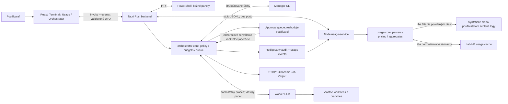

# Lab-M4 — technický plán

Stav: **návrh na schválenie; implementácia nezačala**. Prieskum: 4. 11. 2026 UTC. Tento PR smie meniť iba tento súbor. Wraith bol čítaný výhradne z GitHubu, bez zápisu do jeho repozitára. Žiadne používateľské logy, autentifikačné súbory ani hodnoty poverení neboli čítané. Lokálne pozorovania uvedené v starších dokumentoch sú tvrdenia tých dokumentov, nie nové meranie autora tohto plánu.

**Konvencia dôkazov:** `W:path:riadky` znamená súbor v [Wraith@700f170bcea84b78c1a1fc455f349f49868b5e0d](https://github.com/Wondris404/Wraith/tree/700f170bcea84b78c1a1fc455f349f49868b5e0d); `L:path:riadky` znamená súbor v [Lab-M4/feat/parsers@f84c6a94903a96aaa040b6efcfff2c9adc3a4b82](https://github.com/Wondris404/Lab-M4/tree/f84c6a94903a96aaa040b6efcfff2c9adc3a4b82). Pri JSON/TOML/YAML je alternatívou presný config key. Citácie platia pre tieto nemenné revízie. Všetky budúce súbory, protokoly, limity a pracovné odhady nižšie sú **návrh**, nie tvrdenie o existujúcej implementácii. **NEOVERENÉ** označuje chýbajúci dôkaz, runtime overenie alebo rozhodnutie.

## 1. Súčasný stav

### 1.1 Revízie a rozsah

Wraith: default branch `master`, prečítaná revízia `700f170bcea84b78c1a1fc455f349f49868b5e0d`. Lab-M4: default branch `main`, revízia `ca738b128a2720b8bb2b93908828214b7718df95` („Remove project files“), **prázdny strom**. Nie je tu momentálne Tauri aplikácia ani aktívny usage projekt. Dôkaz: [main commit](https://github.com/Wondris404/Lab-M4/commit/ca738b128a2720b8bb2b93908828214b7718df95), [strom Wraith](https://api.github.com/repos/Wondris404/Wraith/git/trees/700f170bcea84b78c1a1fc455f349f49868b5e0d?recursive=1), `git ls-tree -r` oboch revízií.

Inventár vetiev pred vytvorením `docs/plan`, overený cez [GitHub branches API](https://api.github.com/repos/Wondris404/Lab-M4/branches?per_page=100):

| Vetva | HEAD | Obsah |
| --- | --- | --- |
| `main` | `ca738b128a2720b8bb2b93908828214b7718df95` | Prázdny strom; história obsahuje merge #1 a #2 a následné odstránenie súborov. |
| `feat/mvp` | `67d1d68435d3300efc85469f40f43bf9bc1cbeeb` | Iba `LICENSE`, MIT, copyright Wondris. |
| `feat/skeleton` | `bb992eed0150aa32f59977607114a2d6cfca60fd` | TS kostra, prázdne parsery, ceny, agregácia, Hono, React web, testy a konfigurácia. |
| `feat/discovery` | `94a802efe578299147d62ee3f51c90b7bb6fdc6d` | Kostra + `docs/log-formats.md` a syntetické JSON fixtures. |
| `feat/parsers` | `f84c6a94903a96aaa040b6efcfff2c9adc3a4b82` | Implementované parsery, summary, testy, zstd fixture, premenovanie projektu na Lab-M4. |

[Otvorené PR API](https://api.github.com/repos/Wondris404/Lab-M4/pulls?state=open&per_page=100) v čase prieskumu vrátilo `[]`. `feat/parsers` nie je otvorený PR. Jeho nezahrnuté commity sú `e526e85` (sémantika), `5c789a8` (parsery), `f84c6a9` (názov). Vetvy sa teraz nemenia ani nezlučujú. F1 obnoví a premiestni ich zachovaný obsah zo snapshotu; obyčajný merge staršej už zlúčenej vetvy by nevrátil súbory odstránené na `main`.

### 1.2 Presný strom Wraith do troch úrovní

Zoznam z vyššie uvedeného stromu; adresáre `icons/android/` a `icons/ios/` obsahujú ďalšie úrovne. Žiadny adresár `.github/` ani release skripty v tejto revízii nie sú.

```text
Wraith/
├── .gitignore
├── .vscode/
│   └── extensions.json
├── AGENT.md
├── LICENSE
├── README.md
├── index.html
├── package.json
├── pnpm-lock.yaml
├── public/
│   ├── tauri.svg
│   ├── vite.svg
│   └── wraith-logo.png
├── src-tauri/
│   ├── .gitignore
│   ├── Cargo.lock
│   ├── Cargo.toml
│   ├── build.rs
│   ├── capabilities/
│   │   └── default.json
│   ├── icons/
│   │   ├── 128x128.png
│   │   ├── 128x128@2x.png
│   │   ├── 32x32.png
│   │   ├── 64x64.png
│   │   ├── Square107x107Logo.png
│   │   ├── Square142x142Logo.png
│   │   ├── Square150x150Logo.png
│   │   ├── Square284x284Logo.png
│   │   ├── Square30x30Logo.png
│   │   ├── Square310x310Logo.png
│   │   ├── Square44x44Logo.png
│   │   ├── Square71x71Logo.png
│   │   ├── Square89x89Logo.png
│   │   ├── StoreLogo.png
│   │   ├── android
│   │   ├── icon.icns
│   │   ├── icon.ico
│   │   ├── icon.png
│   │   └── ios
│   ├── src/
│   │   ├── lib.rs
│   │   └── main.rs
│   └── tauri.conf.json
├── src/
│   ├── App.css
│   ├── App.tsx
│   ├── agent/
│   │   ├── AgentMarkdown.tsx
│   │   ├── AgentPaneView.tsx
│   │   ├── commandMarker.ts
│   │   ├── dictation.ts
│   │   ├── orchestratorTypes.ts
│   │   ├── orchestratorWait.ts
│   │   ├── paneBuffer.ts
│   │   ├── tools.ts
│   │   └── useAgent.ts
│   ├── assets/
│   │   ├── ai-agent.svg
│   │   ├── ai-claude.svg
│   │   ├── ai-openai.svg
│   │   ├── ai-opencode.svg
│   │   ├── react.svg
│   │   └── wraith-logo.png
│   ├── main.tsx
│   ├── settings/
│   │   ├── AppSettingsModal.tsx
│   │   ├── applyAppearance.ts
│   │   ├── fonts.ts
│   │   ├── index.ts
│   │   ├── themes.ts
│   │   ├── types.ts
│   │   └── useAppSettings.ts
│   ├── terminalOutput.ts
│   └── vite-env.d.ts
├── tests/
│   └── terminalOutput.test.mjs
├── tsconfig.json
├── tsconfig.node.json
└── vite.config.ts
```

### 1.3 Technológie a existujúce funkcie

| Oblasť | Overený stav a dôkaz |
| --- | --- |
| App | `wraith` 0.2.0; `W:package.json` keys `name`, `version`; `W:src-tauri/Cargo.toml` `[package]`. |
| Frontend | React/React DOM deklarované `^19.1.0`, lock 19.2.7; TypeScript `~5.8.3`, lock 5.8.3; Vite `^7.0.4`, lock 7.3.6; plugin-react `^4.6.0`, lock 4.7.0. `W:package.json:12–28`, `W:pnpm-lock.yaml:7–51`. |
| Tauri | JS API 2.11.1, CLI 2.11.3; Rust `tauri` 2.11.3, `tauri-build` 2.6.3. Deklarácia major `2`; `W:pnpm-lock.yaml:7–51`, `W:src-tauri/Cargo.lock` package entries `tauri`, `tauri-build`. |
| Rust | Edition 2021; crates v locku: `portable-pty` 0.9.0, `tokio` 1.52.3, `serde` 1.0.228, `serde_json` 1.0.150, `reqwest` 0.13.4, `tauri-plugin-dialog` 2.7.1, `tauri-plugin-opener` 2.5.4. `W:src-tauri/Cargo.toml:6–28`, rovnomenné entries Cargo.lock. Verzia kompilátora Rust nie je pinovaná: **NEOVERENÉ**. |
| Terminál | `powershell.exe -NoLogo`, nie automaticky `pwsh`; `portable-pty::native_pty_system`; `windowsPty.backend = conpty`. `W:src-tauri/src/lib.rs:620–646`, `W:src/App.tsx:2163–2184`. Verzia PowerShell závisí od PC: **NEOVERENÉ**. |
| Renderer | xterm 6.0.0, addon-fit 0.11.0, addon-webgl 0.19.0; WebGL len pre viditeľnú reláciu, fallback pri strate kontextu. `W:pnpm-lock.yaml:17–25`, `W:src/App.tsx:904–930,3442`. |
| Stav | React hooks `useState`, `useRef`, `useCallback`; nie Redux/Zustand. PTY mapa v Rust `Mutex<HashMap<String, PtyInstance>>`. `W:src/App.tsx:1372–1461`, `W:src-tauri/src/lib.rs:15–26`. |
| Ukladanie | `~/.wraith/settings.json`, migrácia `~/.wraith/agent.json`; relácie v `app_local_data_dir()/sessions.json`; legacy browser key `wraith:font-size`. `W:src-tauri/src/lib.rs:233–239,303–325,776–809`, `W:src/settings/types.ts:342–359`. |
| Témy | 17 identifikátorov: wraith, vscode-dark, midnight, one-dark, dracula, nord, tokyo-night, catppuccin-mocha, gruvbox-dark, monokai, solarized-dark, forest, ember, light, solarized-light, paper, high-contrast. CSS premenné + xterm paleta; fonty vrátane Google Fonts. `W:src/settings/types.ts:1–18`, `themes.ts:28–67`, `fonts.ts:308,324`, `applyAppearance.ts`. |
| Build | `pnpm dev` → Vite, `pnpm build` → `tsc && vite build`, `pnpm tauri dev/build`; `beforeDevCommand`, `beforeBuildCommand`, `frontendDist` v Tauri config. pnpm verzia vo Wraith nie je pinovaná; lockfileVersion 6.0 nie je dôkaz konkrétnej verzie pnpm. |
| Release/CI/testy | `bundle.active=true`, `targets=all`, 5 bundle ikon; samostatný release workflow ani updater config nie je v prečítanom strome/configu. Existujú `tests/terminalOutput.test.mjs:1–38` a Rust UTF-8 testy `lib.rs:855–875`, hoci README:102 tvrdí, že test suite nie je nastavená. `package.json.scripts` nemá lint/test script. |
| AI dnes | Chat, diktovanie, schvaľovanie `run_command`, `launch_agent`, `prompt_pane`, čítanie panelov; hook server. `W:src/agent/tools.ts:146–159`, `useAgent.ts:232–330,536,724–729`, `dictation.ts:68–86,229–285`, `lib.rs:206–224,607–616`. Nie je to požadovaný bezpečný multi-worker scheduler. |

### 1.4 Terminálová relácia end-to-end

1. `App` registruje `listen("pty-output")`, `listen("pty-exit")`, `listen("agent-finished")`; až potom nastaví `ptyListenersReady`. Predčasný výstup uchová `pendingOutputRef`. `W:src/App.tsx:2107–2160`.
2. `createSession` používa `createWin`; `createWin(cwd, paneId)` volá `invoke("spawn_powershell", {cwd})`, vytvorí `Terminal`, `FitAddon` a `attachPtyListeners`. `W:src/App.tsx:2163–2200,2296`.
3. `run()` registruje Rust príkazy cez `generate_handler!`; `spawn_powershell` otvorí PTY 80 × 24, nastaví cwd a spustí `powershell.exe -NoLogo` cez slave. Master poskytne writer, reader a resize handle; `new_id` identifikuje inštanciu uloženú do `AppState.pty`. `W:src-tauri/src/lib.rs:119–126,620–716,827–843`.
4. xterm `onData` v `attachPtyListeners` normalizuje LF na CR a volá `write_powershell`; Rust zapíše a flushne bajty do PTY. `W:src/App.tsx:933–950`, `W:src-tauri/src/lib.rs:719–734`.
5. Rust reader thread číta bloky 4096 bajtov; `Utf8OutputDecoder::push/finish` drží neúplné UTF-8 sekvencie. Emituje `pty-output {id,data}`; frontend `processPtyData` → `queueTerminalOutput` → `flushTerminalOutput` → `term.write`. Pri EOF emituje `pty-exit`. `W:src-tauri/src/lib.rs:34–73,664–700`, `W:src/App.tsx:786–819,2122–2136`.
6. `fitAndRefresh`/`syncPtySizeForId` a xterm `onResize` → `resize_powershell` → `master.resize`. Zatvorenie pane/session volá `kill_powershell` → `kill_instance`; zatvorenie okna `kill_all`. `W:src/App.tsx:827–950,2651–2740`, `W:src-tauri/src/lib.rs:96–117,737–764,844–848`. Zabitie celého stromu potomkov nie je týmto kódom dokázané: **NEOVERENÉ**, F5 pridá Windows Job Object.

### 1.5 Lab-M4: čo zachovať

`L:package.json` deklaruje Node >=20, pnpm 10.29.3, TS ^5.9, React ^19.1, Vite ^6.4, Hono ^4.9, Zod ^3.25, sqlite3 ^5.1.7, fzstd ^0.1.1, Vitest ^3.2, Recharts ^3.1, Tailwind ^4.1. `pnpm-workspace.yaml.onlyBuiltDependencies=[sqlite3]` zatiaľ neobsahuje workspace packages.

| Časť `feat/parsers` | Funkcia, dôkaz |
| --- | --- |
| `src/core/types.ts:1–26`, `settings.ts:1–52` | `UsageRecord`, štyria providers, Zod validácia ciest, zapnutia, cien a kurzu; loader používa Node fs. |
| `src/parsers/contracts.ts:1–28`, `index.ts` | `ParseResult` s records/warnings/limits/mismatchFields, register. |
| `codex.ts:4–110`, `shared.ts:1–111` | JSONL/zstd streaming, kontext modelu, last usage, deduplikácia kumulatívneho stavu; kontrola názvu/symlinkov. |
| `grok-build.ts:4–75` | `shell.turn.inference_done`, korelácia sid, explicitná session, deduplikácia; unknown bez dôkazu. |
| `opencode.ts:10–117` | SQLite projekcia tokenových polí, preferencia messages pred session summary; aktuálne `immutable=1&mode=ro`. |
| `antigravity.ts:1–7` | Prázdny stub; nemožno prezentovať ako nulovú spotrebu. |
| `src/pricing/index.ts:4–31`, `aggregate/index.ts:3–21` | Odhad USD a totalTokens; byProvider/byModel/byDay sú len interface. |
| `src/server/index.ts:1–26`, `summary.ts:6–75` | Hono 127.0.0.1:3001, health/summary, iba enabled zdroje, EUR kurz, incompleteness flags. |
| `web/`, `vite.config.ts` | React prázdny stav; nejde ešte o dashboard. |
| `tests/`, `fixtures/`, `config/settings.example.json` | Testy settings/pricing/aggregate/parsers; syntetické JSON, zstd; test generuje SQLite. Vzorové zdroje sú vypnuté. |
| `docs/architecture.md`, `docs/log-formats.md`, README, configs, lock | Zachovať všetko. `architecture.md:13,35` a `log-formats.md:99` sú staršie než implementácia; neskoršia sekcia log-formats:109–119 už parsery opisuje. F1 dokumenty opraví, nevymaže. |

### 1.6 Licencia

`W:LICENSE:1–21` je MIT, copyright **2026 Wraith**; vyžaduje zachovať copyright a permission notice v kópiách/podstatných častiach a obsahuje vylúčenie záruk. `L:LICENSE:1–21` je tiež MIT, copyright **2026 Wondris**. Návrh: root `LICENSE` zachová Wondris; presná Wraith licencia bude `apps/desktop/LICENSE` aj distribuovaná ako `licenses/Wraith-LICENSE.txt`. README a About budú hovoriť **„based on Wraith“** a odkazovať na fork i revíziu. Túto atribúciu vyžaduje aj zadanie. Nezamieňať rebrand za zmenu autora pôvodného kódu.

## 2. Cieľová architektúra

### 2.1 Monorepo a zodpovednosti

Návrh: root pnpm 10.29.3, `pnpm-workspace.yaml.packages = [apps/*, packages/*]`, jeden aktívny root pnpm lock a jeden aktívny root Cargo.lock. Importovaný desktop Cargo.lock ostane ako referenčný snapshot (Cargo workspace používa root lock); pri F2 sa aktualizuje iba jeho projektová identita, runtime resolution riadi root lock. Desktop ostáva React/Tauri/PowerShell. `@lab-m4/usage-core` obsahuje zachované Node parsery, ceny, agregácie a nové skenovanie. `@lab-m4/usage-service` je lokálny sidecar; žiadny HTTP server. `packages/orchestrator-core` je **Rust crate**, nie predstieraný Node balík: Cargo workspace ho zdieľa s desktop backendom cez path dependency. UI dostáva verzované DTO cez `@lab-m4/contracts`; Rust ich validuje cez serde a porovnávacie schema testy. Rust neimportuje TypeScript.

Frontend importuje iba browser-safe contracts a formattery. Node exporty usage-core nie sú v dependency grafe webview. Pôvodný Hono/web sa premiestni do `apps/usage-legacy`; nebude spúšťaný desktopom. Existujúce settings loader/parser kódy ostanú zachované. Dôvod rozdelenia: reálne Node importy v `L:src/parsers/shared.ts:1–6`, `opencode.ts:1–2`, `core/settings.ts:1` a úloha PTY v §1.4. Workspace protocol `workspace:*` podľa [pnpm dokumentácie](https://pnpm.io/workspaces).

### 2.2 Úplný cieľový strom

Nasledujúci strom zahŕňa zachované tracked súbory aj navrhnuté nové súbory po F7. Generované `node_modules`, `target`, `dist`, `gen`, sidecar staging a runtime dáta sa necommitujú. Žiadny pôvodný Lab-M4 súbor nesmie zaniknúť; konfigurácie nahradené root workspace konfiguráciou sa presunú do `archive/lab-m4/`. Wraith pôvodné obrázky ostávajú, nové Lab-M4 ikony sú v osobitnom priečinku. Presuny v §7 sú normatívne.

```text
Lab-M4/
├── .gitattributes
├── .github/
│   └── workflows/
│       └── windows-ci.yml
├── .gitignore
├── .prettierignore
├── .prettierrc.json
├── Cargo.lock
├── Cargo.toml
├── LICENSE
├── README.md
├── apps/
│   ├── desktop/
│   │   ├── .gitignore
│   │   ├── .vscode/
│   │   │   └── extensions.json
│   │   ├── AGENT.md
│   │   ├── LICENSE
│   │   ├── README.md
│   │   ├── index.html
│   │   ├── package.json
│   │   ├── public/
│   │   │   ├── lab-m4-logo.png
│   │   │   ├── tauri.svg
│   │   │   ├── vite.svg
│   │   │   └── wraith-logo.png
│   │   ├── src-tauri/
│   │   │   ├── .gitignore
│   │   │   ├── Cargo.lock
│   │   │   ├── Cargo.toml
│   │   │   ├── build.rs
│   │   │   ├── capabilities/
│   │   │   │   └── default.json
│   │   │   ├── icons/
│   │   │   │   ├── 128x128.png
│   │   │   │   ├── 128x128@2x.png
│   │   │   │   ├── 32x32.png
│   │   │   │   ├── 64x64.png
│   │   │   │   ├── Square107x107Logo.png
│   │   │   │   ├── Square142x142Logo.png
│   │   │   │   ├── Square150x150Logo.png
│   │   │   │   ├── Square284x284Logo.png
│   │   │   │   ├── Square30x30Logo.png
│   │   │   │   ├── Square310x310Logo.png
│   │   │   │   ├── Square44x44Logo.png
│   │   │   │   ├── Square71x71Logo.png
│   │   │   │   ├── Square89x89Logo.png
│   │   │   │   ├── StoreLogo.png
│   │   │   │   ├── android/
│   │   │   │   │   ├── mipmap-anydpi-v26/
│   │   │   │   │   │   └── ic_launcher.xml
│   │   │   │   │   ├── mipmap-hdpi/
│   │   │   │   │   │   ├── ic_launcher.png
│   │   │   │   │   │   ├── ic_launcher_foreground.png
│   │   │   │   │   │   └── ic_launcher_round.png
│   │   │   │   │   ├── mipmap-mdpi/
│   │   │   │   │   │   ├── ic_launcher.png
│   │   │   │   │   │   ├── ic_launcher_foreground.png
│   │   │   │   │   │   └── ic_launcher_round.png
│   │   │   │   │   ├── mipmap-xhdpi/
│   │   │   │   │   │   ├── ic_launcher.png
│   │   │   │   │   │   ├── ic_launcher_foreground.png
│   │   │   │   │   │   └── ic_launcher_round.png
│   │   │   │   │   ├── mipmap-xxhdpi/
│   │   │   │   │   │   ├── ic_launcher.png
│   │   │   │   │   │   ├── ic_launcher_foreground.png
│   │   │   │   │   │   └── ic_launcher_round.png
│   │   │   │   │   ├── mipmap-xxxhdpi/
│   │   │   │   │   │   ├── ic_launcher.png
│   │   │   │   │   │   ├── ic_launcher_foreground.png
│   │   │   │   │   │   └── ic_launcher_round.png
│   │   │   │   │   └── values/
│   │   │   │   │       └── ic_launcher_background.xml
│   │   │   │   ├── icon.icns
│   │   │   │   ├── icon.ico
│   │   │   │   ├── icon.png
│   │   │   │   ├── ios/
│   │   │   │   │   ├── AppIcon-20x20@1x.png
│   │   │   │   │   ├── AppIcon-20x20@2x-1.png
│   │   │   │   │   ├── AppIcon-20x20@2x.png
│   │   │   │   │   ├── AppIcon-20x20@3x.png
│   │   │   │   │   ├── AppIcon-29x29@1x.png
│   │   │   │   │   ├── AppIcon-29x29@2x-1.png
│   │   │   │   │   ├── AppIcon-29x29@2x.png
│   │   │   │   │   ├── AppIcon-29x29@3x.png
│   │   │   │   │   ├── AppIcon-40x40@1x.png
│   │   │   │   │   ├── AppIcon-40x40@2x-1.png
│   │   │   │   │   ├── AppIcon-40x40@2x.png
│   │   │   │   │   ├── AppIcon-40x40@3x.png
│   │   │   │   │   ├── AppIcon-512@2x.png
│   │   │   │   │   ├── AppIcon-60x60@2x.png
│   │   │   │   │   ├── AppIcon-60x60@3x.png
│   │   │   │   │   ├── AppIcon-76x76@1x.png
│   │   │   │   │   ├── AppIcon-76x76@2x.png
│   │   │   │   │   └── AppIcon-83.5x83.5@2x.png
│   │   │   │   └── lab-m4/
│   │   │   │       ├── 128x128.png
│   │   │   │       ├── 128x128@2x.png
│   │   │   │       ├── 32x32.png
│   │   │   │       ├── icon.icns
│   │   │   │       ├── icon.ico
│   │   │   │       └── icon.png
│   │   │   ├── permissions/
│   │   │   │   └── app.toml
│   │   │   ├── src/
│   │   │   │   ├── lib.rs
│   │   │   │   ├── main.rs
│   │   │   │   ├── orchestrator.rs
│   │   │   │   ├── paths.rs
│   │   │   │   ├── sidecar.rs
│   │   │   │   └── usage.rs
│   │   │   ├── tauri.conf.json
│   │   │   └── tests/
│   │   │       ├── coexistence.rs
│   │   │       └── usage_ipc.rs
│   │   ├── src/
│   │   │   ├── App.css
│   │   │   ├── App.tsx
│   │   │   ├── agent/
│   │   │   │   ├── AgentMarkdown.tsx
│   │   │   │   ├── AgentPaneView.tsx
│   │   │   │   ├── commandMarker.ts
│   │   │   │   ├── dictation.ts
│   │   │   │   ├── orchestratorTypes.ts
│   │   │   │   ├── orchestratorWait.ts
│   │   │   │   ├── paneBuffer.ts
│   │   │   │   ├── tools.ts
│   │   │   │   └── useAgent.ts
│   │   │   ├── assets/
│   │   │   │   ├── ai-agent.svg
│   │   │   │   ├── ai-claude.svg
│   │   │   │   ├── ai-openai.svg
│   │   │   │   ├── ai-opencode.svg
│   │   │   │   ├── lab-m4-logo.png
│   │   │   │   ├── react.svg
│   │   │   │   └── wraith-logo.png
│   │   │   ├── main.tsx
│   │   │   ├── orchestrator/
│   │   │   │   ├── ApprovalQueue.tsx
│   │   │   │   ├── BudgetBar.tsx
│   │   │   │   ├── Controls.tsx
│   │   │   │   ├── OrchestratorTab.test.tsx
│   │   │   │   ├── OrchestratorTab.tsx
│   │   │   │   ├── SessionLog.tsx
│   │   │   │   ├── TaskBoard.tsx
│   │   │   │   ├── WorkerPane.tsx
│   │   │   │   └── useOrchestrator.ts
│   │   │   ├── settings/
│   │   │   │   ├── About.tsx
│   │   │   │   ├── AppSettingsModal.tsx
│   │   │   │   ├── applyAppearance.ts
│   │   │   │   ├── fonts.ts
│   │   │   │   ├── index.ts
│   │   │   │   ├── themes.ts
│   │   │   │   ├── types.ts
│   │   │   │   └── useAppSettings.ts
│   │   │   ├── terminalOutput.ts
│   │   │   ├── usage/
│   │   │   │   ├── AgentBreakdown.tsx
│   │   │   │   ├── DailyChart.tsx
│   │   │   │   ├── ModelDayTable.tsx
│   │   │   │   ├── SessionTable.tsx
│   │   │   │   ├── SourceSettings.tsx
│   │   │   │   ├── SummaryCards.tsx
│   │   │   │   ├── UsageTab.test.tsx
│   │   │   │   ├── UsageTab.tsx
│   │   │   │   ├── format.test.ts
│   │   │   │   ├── format.ts
│   │   │   │   └── useUsage.ts
│   │   │   └── vite-env.d.ts
│   │   ├── tests/
│   │   │   └── terminalOutput.test.mjs
│   │   ├── tsconfig.json
│   │   ├── tsconfig.node.json
│   │   └── vite.config.ts
│   ├── usage-legacy/
│   │   ├── package.json
│   │   ├── src/
│   │   │   └── server/
│   │   │       └── index.ts
│   │   ├── tsconfig.json
│   │   ├── tsconfig.server.json
│   │   ├── vite.config.ts
│   │   └── web/
│   │       ├── index.html
│   │       └── src/
│   │           ├── main.tsx
│   │           └── style.css
│   └── usage-service/
│       ├── package.json
│       ├── src/
│       │   ├── main.ts
│       │   └── protocol.ts
│       ├── tests/
│       │   └── protocol.test.ts
│       └── tsconfig.json
├── archive/
│   ├── lab-m4/
│   │   ├── package.json
│   │   ├── pnpm-lock.yaml
│   │   └── pnpm-workspace.yaml
│   └── wraith/
│       └── pnpm-lock.yaml
├── docs/
│   ├── PLAN-lab-m4.md
│   ├── architecture.md
│   ├── cli-compatibility.md
│   ├── log-formats.md
│   └── usage-legacy-README.md
├── eslint.config.js
├── licenses/
│   └── Wraith-LICENSE.txt
├── package.json
├── packages/
│   ├── contracts/
│   │   ├── package.json
│   │   ├── schemas/
│   │   │   ├── orchestrator.schema.json
│   │   │   └── usage.schema.json
│   │   ├── src/
│   │   │   ├── orchestrator.ts
│   │   │   └── usage.ts
│   │   └── tsconfig.json
│   ├── orchestrator-core/
│   │   ├── Cargo.toml
│   │   ├── src/
│   │   │   ├── adapters/
│   │   │   │   ├── antigravity.rs
│   │   │   │   ├── codex.rs
│   │   │   │   ├── copilot.rs
│   │   │   │   ├── grok.rs
│   │   │   │   ├── manager_codex.rs
│   │   │   │   ├── mod.rs
│   │   │   │   └── opencode.rs
│   │   │   ├── approval.rs
│   │   │   ├── audit.rs
│   │   │   ├── broker.rs
│   │   │   ├── budget.rs
│   │   │   ├── job.rs
│   │   │   ├── lib.rs
│   │   │   ├── policy.rs
│   │   │   ├── session.rs
│   │   │   ├── supervisor.rs
│   │   │   └── worktrees.rs
│   │   └── tests/
│   │       ├── adapters.rs
│   │       ├── enforcement.rs
│   │       ├── fixtures/
│   │       │   ├── antigravity.jsonl
│   │       │   ├── codex.jsonl
│   │       │   ├── copilot.jsonl
│   │       │   └── opencode.jsonl
│   │       ├── lifecycle.rs
│   │       └── session.rs
│   └── usage-core/
│       ├── config/
│       │   └── settings.example.json
│       ├── fixtures/
│       │   ├── .gitkeep
│       │   ├── antigravity/
│       │   │   └── metadata.json
│       │   ├── codex/
│       │   │   ├── usage-1.json
│       │   │   └── usage-2.json
│       │   ├── grok-build/
│       │   │   ├── metadata.json
│       │   │   └── usage.json
│       │   ├── opencode/
│       │   │   ├── message.json
│       │   │   └── session.json
│       │   └── synthetic/
│       │       ├── codex.jsonl.zst
│       │       ├── rotation.jsonl
│       │       ├── truncated.jsonl
│       │       └── unknown-cost.json
│       ├── package.json
│       ├── src/
│       │   ├── aggregate/
│       │   │   ├── dashboard.ts
│       │   │   └── index.ts
│       │   ├── cache.ts
│       │   ├── core/
│       │   │   ├── settings.ts
│       │   │   └── types.ts
│       │   ├── exportCsv.ts
│       │   ├── liveUsage.ts
│       │   ├── parsers/
│       │   │   ├── antigravity.ts
│       │   │   ├── codex.ts
│       │   │   ├── contracts.ts
│       │   │   ├── grok-build.ts
│       │   │   ├── index.ts
│       │   │   ├── opencode.ts
│       │   │   └── shared.ts
│       │   ├── pricing/
│       │   │   └── index.ts
│       │   ├── privacy.ts
│       │   ├── scanner.ts
│       │   ├── server/
│       │   │   └── summary.ts
│       │   └── sources.ts
│       ├── tests/
│       │   ├── aggregate.test.ts
│       │   ├── dashboard.test.ts
│       │   ├── exportCsv.test.ts
│       │   ├── ipc.test.ts
│       │   ├── liveUsage.test.ts
│       │   ├── parsers.test.ts
│       │   ├── pricing.test.ts
│       │   ├── records.ts
│       │   ├── scanner.test.ts
│       │   └── settings.test.ts
│       └── tsconfig.json
├── pnpm-lock.yaml
├── pnpm-workspace.yaml
├── scripts/
│   ├── package-usage-sidecar.mjs
│   ├── sidecar-runtime.json
│   ├── test-changed.mjs
│   └── verify-preservation.mjs
├── tools/
│   └── fake-worker/
│       ├── main.mjs
│       └── package.json
├── tsconfig.json
└── vitest.config.ts
```

### 2.3 Komponenty a dáta



Zostane rozloženie panelov, sessions/sidebar, presúvanie/resize, terminal rendering, témy a nastavenia vzhľadu. Premenujú sa identity a cesty (§3). Nové sú Usage, sidecar, worker scheduler, worktrees, preukázateľné enforcement pravidlá a audit. **Konflikt požiadaviek:** Wraith API chat/diktovanie dnes závisia od `apiKey` (`W:src/agent/useAgent.ts:202–211,724–729`, `dictation.ts:68–86`). Nemožno súčasne zachovať tento mechanizmus identicky a nikdy neukladať kľúče. Odporúčanie: zachovať zdroje, vypnúť pôvodnú credential-backed cestu, chat nahradiť CLI managerom; diktovanie zostane nedostupné, kým sa neschváli riešenie bez kľúčov. Toto je otvorené rozhodnutie č. 2, nie skrytá strata funkcie.

## 3. Rebranding a koexistencia s Wraithom

### 3.1 Inventár premenovaní

Cesty v tabuľke sú pôvodné W cesty; v Lab-M4 získajú prefix `apps/desktop/`.

| Miesto / aktuálna hodnota | Návrh Lab-M4 |
| --- | --- |
| `package.json.name=wraith`; Cargo `[package].name=wraith`, `[lib].name=wraith_lib`; `src-tauri/src/main.rs` volá `wraith_lib::run` | `@lab-m4/desktop`, `lab-m4`, `lab_m4_lib`, opraviť call site; verziu začať 0.1.0, aktualizovať lock entries. |
| `tauri.conf.json.productName`, `app.windows[0].title`, `identifier` | `Lab-M4`, `Lab-M4`, **`com.wondris.labm4`**. Bundle artefakty a shortcut Lab-M4. |
| `index.html:5–7`, `src/App.tsx:16,3697`, README a AGENT.md | Názov, alt text, favicon, logo Lab-M4; atribúcia based on Wraith ostáva. |
| `public/wraith-logo.png`, `src/assets/wraith-logo.png`, `src-tauri/icons/**`, `build.rs:3–4` | Pôvodné assets ponechať ako pôvodné; nové `lab-m4-logo.png` a `icons/lab-m4/{32x32.png,128x128.png,128x128@2x.png,icon.icns,icon.ico,icon.png}`. Bundle icon list a build rerun paths prepnúť na nové. |
| `lib.rs:233–239,303–325,499–539` | Settings už nie v `.wraith`; používať Lab-M4 app config directory. Žiadne automatické čítanie/migrovanie Wraith ani agent auth nastavení. |
| `lib.rs:776–809` | `sessions.json` pod app local data directory pre nový identifier. |
| `settings/types.ts:342–359` | Legacy `wraith:font-size` sa nečíta; prípadný nový key `lab-m4:font-size`; oddelený WebView profile. |
| `settings/types.ts:1–18,125,155`, `themes.ts:65–68,631–632`, Rust default theme | Zachovať 17 paliet; `wraith` premenovať na `lab-m4` v aktívnych defaults a type unions, pôvodný pôvod palety uviesť v About. |
| `agent/useAgent.ts:167,207–208,330`, `agent/dictation.ts:84–85` | Názvy/prompt/referer/X-Title zmeniť na Lab-M4, ale credential-backed moduly sú mimo aktívneho toku. Nepredstierať funkčný API provider. |
| `agent/commandMarker.ts:1,35–47,71` | `__LAB_M4_AGENT_DONE__`, `LAB_M4_AGENT_*`, `$labM4ExitCode`; legacy marker nikdy nie dôkaz orchestrator done. |
| `lib.rs:354–485,607–616`; `App.tsx:1928–1939` | Vypnúť automatickú inštaláciu hookov do `.codex/hooks.json`, `.claude/settings.json`, `.grok/hooks/wraith-finished.json`, `.config/opencode/plugins/wraith-notify.js`. Zachovať pôvodný kód ako legacy, nepoužiť pre nové workers. |
| `vite.config.ts.server.port=1420`, `hmr.port=1421`; Tauri `build.devUrl` | Lab-M4 dev 1430, HMR 1431, `http://localhost:1430`. Port obsadený → jasná chyba, žiadne pripojenie k inej aplikácii. |
| Updater, registry, shell | Updater plugin/endpoints, vlastné registry/protocol/file associations a shell installer skripty sa v úplnom strome ani configu nenašli. Nič neprepisovať „pre istotu“. Generované MSI/NSIS registry identity a install/uninstall koexistencia sú **NEOVERENÉ** do F2 testu. |

### 3.2 Dôkaz a hranice dôkazu

Aktuálne sa nedá tvrdiť, že Lab-M4 už bezpečne koexistuje: nemá aplikáciu a prostá kópia Wraith by zdieľala `.wraith` aj hooks. Dôkaz pre navrhnuté oddelenie:

- `W:tauri.conf.json.identifier=com.wraith.app` oproti návrhu `com.wondris.labm4`. Tauri [appLocalDataDir](https://v2.tauri.app/reference/javascript/api/namespacepath/#applocaldatadir) používa bundle identifier. `W:lib.rs:776–780` túto funkciu už využíva. Rovnaký princíp použijeme pre settings/cache/logs; žiadny `appDirectoriesOverride` na Wraith cestu.
- Návrh ciest na Windows: `%APPDATA%/com.wondris.labm4/settings.json`; `%LOCALAPPDATA%/com.wondris.labm4/{sessions.json,usage/cache.sqlite,orchestrator/sessions/<id>/events.jsonl}`; logy a cache výhradne pod Lab-M4 koreňom. Skutočný výsledok path resolvera a WebView2 user-data profile sa overí v F2, **NEOVERENÉ** na tomto Linux sandboxe.
- `W:lib.rs:206–213` binduje hook listener na `127.0.0.1:0`, teda OS pridelí port; nie je to pevný zdieľaný port. Nový Orchestrator použije stdio, bez tohto servera. Ak ponechaná legacy notifikácia potrebuje listener, ostane iba per-process ephemeral port bez globálnych hookov.
- Desktop nebude spúšťať legacy Hono port 3001. Dev porty sú rozdielne podľa tabuľky. Agent vlastné porty sú **NEOVERENÉ** pre konkrétnu nainštalovanú verziu; adaptér, ktorý port potrebuje, musí mať per-worker random bind a vlastný endpoint, inak sa nezapne.
- Používateľom nainštalované CLIs môžu naďalej používať svoje vlastné prihlásenie/logy v oboch termináloch. To nie sú spoločné **nastavenia alebo dáta Lab-M4 a Wraith**. Lab-M4 tieto auth súbory nečíta ani nekopíruje. Úplné oddelenie dát samotných tretích CLI by vyžadovalo podporu ich profile režimov: **NEOVERENÉ**, rozhodnutie č. 3.

Akceptačný dôkaz F2: oba nainštalované buildy súčasne, rozdielne settings/session/profile cesty, odlišný vzhľad po reštarte, odinštalovanie Lab-M4 neovplyvní Wraith, žiadny zápis hookov do cudzích priečinkov. Porovnávať iba metadáta povolených súborov, nikdy auth obsah.

## 4. Usage modul — návrh

### 4.1 Kde vykonávať parsery

| Varianta | Výhody | Nevýhody |
| --- | --- | --- |
| Frontend/webview | Jednoduchý rendering a čisté výpočty | Existujúce `node:fs`, Node streams a native `sqlite3` tam nemožno priamo spustiť. Vyžaduje nové I/O API a refaktor; žiadny polyfill s prístupom k celému disku. Dôkaz Node závislostí: §1.5. |
| Rust | Jedna backend autorita, dobré filesystem hranice | Prepísanie troch TS parserov, parity testy a nová zstd/SQLite implementácia; pôvodný kód sa aj tak musí zachovať. Vyššie riziko sémantických rozdielov. |
| **Node sidecar — vybrané** | Zachová overované TS algoritmy/fzstd/sqlite3; oddelí skenovanie od UI | Balenie Node + native sqlite3 pre Windows, veľkosť distribúcie, lifecycle a IPC. Kompatibilita balenia **NEOVERENÉ** do F3 spike. |

Návrh: Rust spustí iba pribalený, hashom overený Node runtime s pevnou vstupnou cestou `usage-service/dist/main.js`; používa pipes, nie shell command string. `bundle.externalBin` obsahuje runtime s target suffixom; `bundle.resources` deploynutý JS a sqlite3 addon, licencie a manifest. Podpora externe balených binárok je popísaná v [Tauri sidecar docs](https://v2.tauri.app/develop/sidecar/). Konkrétnu verziu Node LTS a natívny addon pinovať po F3 overení na Windows x64, nie hádať kompatibilitu. Inštalovaný Lab-M4 nesmie vyžadovať systémový Node/pnpm. ARM64 je samostatná otázka č. 7.

`usage-core` poskytne `./contracts` bez Node importov a `./node` s parsers/scanner. `usage-service` metódy: `scan`, `cancelScan`, `querySummary`, `queryRecords`, `exportCsv`, `ingestOrchestratorUsage`; IPC envelope `{version:1, requestId, method, params}` → `{requestId,result|error}`. Limit správy návrh 1 MiB, paging 500 records, bounded concurrency 2, cancellation a backpressure. Rust nikdy nepreposiela arbitrary názov metódy/cestu z webview. Základná konfigurácia sidecar env bez key premenných a bez logovania env; sidecar nepotrebuje auth ani sieť.

### 4.2 Čítanie, incremental scan a cache

Zdroj formátov je **výhradne** `L:docs/log-formats.md:12–119` a `L:fixtures/**`, `tests/parsers.test.ts`. Tieto vzorky nie sú dôkaz úplnej histórie všetkých nainštalovaných verzií.

- Používateľ explicitne zapne zdroj a vyberie jeho root/súbor. Povolené vzory: Codex `sessions/**/*.jsonl[.zst]`, `archived_sessions/**/*.jsonl[.zst]`; Grok konkrétny `logs/unified.jsonl` a explicitne zvolené rotované JSONL; OpenCode konkrétny `opencode.db`; Antigravity zatiaľ nič neskenuje. Žiadny disk-wide discovery. Paths z dokumentu sú návrhy vo výbere, nie automatické čítanie.
- Zachovať deny názvy z `shared.ts:20` a sprísniť kontrolu každého path segmentu, canonical containment, symlink/junction/reparse odmietnutie a kontrolu file handle pred čítaním. Auth/credential/token/secret/key/login/.env súbory sa nesmú otvoriť. I/O otvorenie iba read-only. JSONL sa parsuje po riadkoch; povolené polia sa projektujú ihneď, raw obsah sa neukladá/neodosiela. Pole `token_count` v povolenom logu je metrika, nie auth token.
- Cache: Lab-M4 `usage/cache.sqlite`; iba normalizované počty, model/provider, anonymizované ID, čas, price provenance, scan state. Kľúč zdroja = provider + canonical path hash; `mtimeNs`, size, file identity, parser/schema version, posledný dokončený offset, čiastočný riadok, kontext a dedupe stav. Cesty na disku zostávajú v lokálnych nastaveniach, nie v CSV/audite.
- Nezmenené mtime+size preskočiť; plain JSONL append číta od dokončeného offsetu. Skrátenie, rotácia alebo zmena parsera → transakčné prečítanie zdroja a výmena jeho záznamov. Re-scan tlačidlo obíde mtime cache. Nezmenené metadáta samy nepreukazujú nemenný obsah; periodická reconciliation a explicitný full rescan.
- `.zst` bez potvrdeného seek indexu: nezmenený archív preskočiť, zmenený stream od začiatku; netvrdiť, že byte offset komprimovaného súboru je JSONL offset. Limit dekomprimovaných bajtov/riadku a cancellation; návrh max riadok 1 MiB, pamäť fronty 16 MiB, na limit upozorniť a označiť partial.
- OpenCode: aktuálne `immutable=1` je vhodné len pre nemenný snapshot. [SQLite URI](https://www.sqlite.org/uri.html) varuje pred zmenami súboru v immutable režime. F3 pre live zdroj použije `OPEN_READONLY`, `mode=ro`, krátku read transaction, `query_only`, explicitné SELECT projekcie; žiadny checkpoint, ATTACH, VACUUM ani zmena journal mode. Podľa [SQLite WAL](https://www.sqlite.org/wal.html#read_only_databases) overiť čitateľné existujúce WAL/SHM a no-write správanie; ak to platforma negarantuje, live import odmietnuť s vysvetlením a podporiť používateľom pripravený uzavretý syntetický/exportovaný snapshot. Nekopírovať celú osobnú databázu do cache. Detekovať mtime/size DB aj WAL; pri zmene bezpečný rescan, nie len časový watermark (záznamy sa môžu aktualizovať).
- Cache transakcia spolu uloží records aj cursor; crash nesmie posunúť cursor bez records. Neznáma schéma/zamknutý súbor → diagnostika bez obsahu, backoff, starý snapshot s `stale` stavom. Uchovať provenance a počet odmietnutých/duplicitných záznamov.

### 4.3 Normalizácia a ceny

`UsageRecord` invariant z `L:src/core/types.ts:15–22`: input zahŕňa cached input, output zahŕňa reasoning; `total=inputTokens+outputTokens`. Cache ani reasoning sa druhýkrát nepripočítajú.

| Agent | Pravidlo a dôkaz |
| --- | --- |
| OpenCode | `inputTokens=input+cache.read+cache.write`, `cachedInputTokens=cache.read`, `outputTokens=output+reasoning`, `reasoningTokens=reasoning`. `L:opencode.ts:31–64`; syntetický príklad 100+20+3 → 123 input, 10+4 → 14 output, spolu 137 (`tests/parsers.test.ts:161–225`). |
| Codex | `total_token_usage` je kumulatívne; počítať `last_token_usage`, cumulative stav len pre dedupe/diagnostiku. `L:codex.ts:33–101`, `docs/log-formats.md:103,111`. Vzorky 110 + 55 = 165, nie 110 + 165; samotné JSON výrezy nemajú kompletný session/model kontext. |
| Grok Build | Cache je podmnožina prompt, reasoning podmnožina completion; `prompt_tokens+completion_tokens`. `L:grok-build.ts:30–70`, `docs/log-formats.md:104,115`; vzorka 100+10=110, nie 134. `sid` nie je automaticky session ID. |
| Antigravity | Zachovať prázdny history parser, UI „história nepodporovaná“, nie 0. `L:antigravity.ts:1–7`, `docs/log-formats.md:77–91`. Dokumentovaný CLI live usage (§5) nepotvrdzuje historický SQLite formát. |
| Copilot / ďalší | Historické formáty nie sú v podkladoch: **NEOVERENÉ**. F7 pripojí live usage iba pri overenej sémantike, history bez novej špecifikácie nepísať. |

Návrh rozšíriť DTO o `recordId`, `sourceId`, `sourceKind`, `providerSessionId`, `runId`, `cacheWriteTokens?`, `costCurrency?`, `priceVersion?`, `coverage`; neprepisovať existujúce počty na nulové pri chýbajúcich poliach. Cenotvorba pri cache write musí mať samostatnú sadzbu alebo explicitne potvrdené účtovanie ako input. Model/speed unknown zostáva unknown (`pricing/index.ts:22–25`). Nesúlad provider total → warning, components sa zachovajú; chýbajúce povinné counts → preskočiť, partial coverage.

**Oprava návrhom:** súčasný OpenCode parser vkladá neoverené `cost` do `costUsd` (`opencode.ts:48–63`), hoci `docs/log-formats.md:70–72` menu nepotvrdzuje. F3 oddelí reported cost od USD ceny; bez potvrdenej meny nezahrnúť do EUR. „skutočné“ iba pre preukázaný účtovaný údaj s menou/provenance; vypočítaná alebo providerom odhadnutá cena „odhad“; chýbajúca „neznáme“, nikdy 0. EUR = USD × používateľom zadaný kurz s dátumom; nejde o automatický aktuálny kurz. Čiastkový súčet + počet neocenených záznamov zobrazovať spolu.

Import z orchestrator live streamu a následný agent log nesmie zdvojiť spotrebu: upsert podľa provider session + request/turn ID, prednosť overenému záznamu. Ak nie je stabilný spoločný identifikátor, zobraziť prekrytie ako nevyriešené a nedávať oba zdroje do jedného definitívneho total. Manager aj pracovníci patria do Usage samostatne, vrátane retry a zlyhaných platených behov.

### 4.4 UI Usage

Návrh tabu: hore časový rozsah, timezone a filtre agent/model/speed; status „naposledy skenované“, dostupnosť a partial/stale warnings. Karty celková cena EUR, sessions (unikátne provider+session), celkové tokeny; per-agent breakdown; denný graf; input/cache write/cache read/output/reasoning; cena podľa typu a standard/fast/unknown; tabuľka model × deň s tokenmi/cenou/coverage; zoznam sessions a CSV export z rovnakých filtrov.

Každá cena má label **odhad / skutočné / neznáme**; zmiešané súčty rozčleniť, neoznačiť celý súčet ako skutočný. Neznáme sessions nezlúčiť do jednej falošnej relácie. Antigravity/Copilot bez histórie majú viditeľnú medzeru pokrytia. „Úplná história“ znamená všetky čitateľné podporované lokálne záznamy, nie sľub obnovy zmazaných logov.

Čísla: požadovaný produktový formát `1.234.567`, desatinná čiarka, kompaktné `1,5k`, `2,3 mil`, `1 mld`; plná hodnota v tooltip/accessible label. Implementovať explicitný formatter s testami hraníc 999/1000/999950/1e6/1e9; nespoliehať sa, že default locale grouping dá bodky. Cena napr. `1.234,56 €`. CSV UTF-8, ISO dátum + timezone, raw numerické stĺpce s dokumentovaným desatinným formátom, semicolon delimiter, ochrana formula injection v textových bunkách; bez promptov, absolútnych ciest a osobných názvov. Export vytvára iba používateľom zvolený nový súbor, prepísanie vyžaduje potvrdenie.

## 5. Orchestrator mode — návrh

### 5.1 Model relácie a overené rozhrania CLI

`OrchestratorSession` obsahuje `sessionId`, repo/base SHA, manager profil, N worker profilov, budgets, stav a audit sequence. Každý worker má vlastný `workerId`, branch, worktree, proces a terminálový panel. Manager je samostatný CLI proces; model je parameter profilu, nie názov executable. Dostupnosť **Astra** a jej konkrétneho model ID v používateľovej CLI/subskripcii je **NEOVERENÉ**. Odporúčanie F5: manager cez už prihlásený Codex CLI s používateľom dostupným modelom + jediný worker Grok Build. To neznamená nasadiť Codex ako worker pred F7.

Oficiálne dokumenty prečítané 4. 11. 2026; nasledujúce príkazy sú príklady protokolu, **nie príkazy spustené v tejto úlohe**, ani hotové bezpečnostné launch profily:

| CLI | Headless / machine output overené v dokumentácii | Hranica overenia |
| --- | --- | --- |
| Codex | `codex exec --json "task"`; stdout JSONL, `thread.started`, `turn.completed`, `turn.failed`, `item.*`; `--output-schema` pre finálny JSON. [Oficiálny non-interactive režim](https://developers.openai.com/codex/noninteractive/). | Verzia na PC, dostupný manager model a úplné approval sprostredkovanie sú **NEOVERENÉ**. |
| Grok Build | `grok -p "task" --output-format streaming-json`; `json` pre finálny objekt; `--cwd`, `--session-id`, `--resume`; ACP `grok agent stdio`. [Oficiálny headless režim](https://docs.x.ai/build/cli/headless-scripting). | Presná event schema/permission handshake konkrétnej verzie sa musí pinovať a overiť v F5; **NEOVERENÉ**. |
| GitHub Copilot | `copilot -p "task" --output-format=json`; JSONL. `--available-tools`, `--deny-tool` existujú. [Programmatic reference](https://docs.github.com/en/copilot/reference/copilot-cli-reference/cli-programmatic-reference). | Nie staré `gh copilot`. Schéma finálneho eventu bežného promptu sa nesmie zameniť za `workflow.result`; **NEOVERENÉ** do F7 kontraktového testu. |
| Antigravity | `agy -p "task" --output-format stream-json`; `init`, `step_update`, `result`; režim `--input-format stream-json` podporuje ďalšie prompty. [Oficiálny headless režim](https://antigravity.google/docs/cli/headless/). | Live usage je zdokumentované; historický parser ostáva stub. Semantika thinking/cache a schvaľovanie každej operácie konkrétnej verzie **NEOVERENÉ**. |
| OpenCode | `opencode run --format json "task"`; raw JSON events, `--model`, `--session`. [Oficiálna CLI referencia](https://opencode.ai/docs/cli/). | Presné udalosti done a approval routing **NEOVERENÉ** do F7. Nepoužiť zdieľaný `serve` port ako skrytú závislosť. |

Nainštalované CLI si používateľ prihlási sám. Lab-M4 umožní vybrať executable, overí jeho canonical path/verziu bez spúšťania loginu a nebude parsovať auth files. Spustenie používateľom vybranej CLI, ktorá sama obsluhuje svoje poverenia, nie je oprávnenie Lab-M4 čítať tieto poverenia. Žiadne kopírovanie auth do worktrees ani nastavovanie API key v konfigurácii aplikácie. Model profily obsahujú iba CLI, model ID a povolené nesenzitívne options.

### 5.2 Úlohy, spätná väzba a done

Návrh interného task envelope:

```json
{
  "version": 1,
  "sessionId": "session-synthetic-1",
  "taskId": "task-1",
  "workerId": "worker-grok-1",
  "baseCommit": "<validated-sha>",
  "objective": "Add a synthetic fixture parser test",
  "allowedPaths": ["packages/usage-core/tests/"],
  "acceptance": ["The selected parser test passes"],
  "budget": {"tokens": 20000, "costEur": 1.0},
  "timeoutSeconds": 600,
  "attempt": 1
}
```

Manager vracia iba schema-validované návrhy `assignTask`, `requestAction`, `summarize`, `finishSession`; nemá priamy shell ani možnosť schváliť vlastnú operáciu. Rust overí worktree ID, base SHA, existenciu vstupných súborov, povolené cesty a zostávajúci rozpočet. Výstup modelu nie je autorita na rozšírenie policy.

Worker stdout/stderr zachytáva supervisor oddelene; machine stream ide do versioned adaptera, bezpečne vykreslená kópia do jeho xterm panelu. Headless proces má vlastný panel aj pri pipe transporte; nenútiť JSON cez PTY, ktoré môže miešať echo/ANSI a stderr. Bežné interaktívne CLI môže bežať cez existujúce PTY, ale vtedy je to manuálny terminál, nie garantovaný riadený worker. Jeden worker slot môže obnovovať samostatný proces pre každý turn, pričom drží provider session ID.

`WorkerResult={taskId,status,exitCode,changedPaths,diffHash,checks,usage,summary}`; summary obmedzené napr. 8 KiB, vždy s referenciou na merateľné diff/check výsledky. Manager dostáva výsledok, redigovaný súhrn a potvrdené paths, nikdy celý nekontrolovaný transcript ako systémové inštrukcie.

Done = potvrdený terminal event adaptéra + príslušný proces/turn skončil úspešne + nezostali otvorené approvals + nezávisle overené acceptance. Výstup „done“, shell prompt, ticho ani Wraith marker nestačia. Pri dokumentovanom finálnom JSON namiesto stream eventu validovať envelope a exit code. EOF bez výsledku → `incomplete`, nonzero → `failed`; neopakovať ne-idempotentnú úlohu automaticky. Presné event predicates Grok/Copilot/OpenCode sú gate F5/F7, nie odhad názvov.

### 5.3 Worktrees, approval queue a vykonávanie

Supervisor pripraví `git worktree add -b orchestrator/<session>/<worker> <repo>/.lab-m4/worktrees/<session>/<worker> <baseSha>`; branch/ref/path vytvára sám z validovaných IDs, nie z modelového textu. Každý worker iný branch a adresár; `.lab-m4/` ignorovať. Worktrees zachovať po STOP/crash; čistenie až po explicitnom UI schválení. [Git worktree dokumentácia](https://git-scm.com/docs/git-worktree) potvrdzuje samostatné working trees, ale zdieľané repository metadáta: **worktree nie je bezpečnostný sandbox**.

**Povinná hranica F5:** procesový wrapper alebo regex nad promptom nezachytí vnorený shell, skript, git knižnicu ani sieťový push. Riadený worker môže byť zapnutý iba vtedy, keď adaptér preukáže pre-execution permission handshake pre všetky mutujúce nástroje a zabráni obchádzaniu cez native tools, hooks, plugins a MCP. Návrh: broker vlastní vykonávanie príkazov a zápisy; CLI má len explicitne povolené čítanie a broker nástroje. Native shell/write/network tools musia byť blokované alebo rovnako sprostredkované. OS confinement musí obmedziť potomkov a zápis mimo worktree; Job Object sám rieši lifecycle, nie filesystem/network sandbox.

Konkrétne Windows confinement + CLI permission protokoly ešte nie sú dokázané: **NEOVERENÉ, blokujúci spike F5**. Ak CLI nedovolí vynútiteľné sprostredkovanie, adaptér je `unsupported-for-managed-mode`; zostane iba fake/dry-run a manuálny terminal launch. **Nesmie sa nahradiť „dôveruj promptu“ ani automatickým yolo.** Pred pokračovaním je potrebná úprava plánu, nie improvizácia. Rovnaká hranica platí pre manager CLI.

Approval item: `{approvalId,workerId,taskId,operation,executable,argv,cwd,paths,diffHash,policyVersion,expiresAt}`. UI zobrazí účinok a konkrétny diff/príkaz; approve je jednorazové a viazané na hash, zamietnutie alebo zmena parametrov ruší token. Žiadne session-wide „approve all“. Queue je autoritatívna v Rust, nie v React; čakajúce operácie sa bez rozhodnutia nevykonajú.

Presné kategórie/patterny, case-insensitive pri Windows command names, ktoré vyžadujú schválenie alebo sú úplne zakázané:

| Pattern / operácia | Policy |
| --- | --- |
| `git push ...`, vrátane `git -C <path> push`, `git -c ... push`; HTTP/SSH/API ekvivalent zápisu vzdialeného repozitára | UI approval pre konkrétny feature ref, nikdy `main`; sieťový zápis mimo brokera blokovať. |
| `git merge ...`, `gh pr merge ...`, API merge | Pre tento projekt merge vykonáva len používateľ; workerovi vždy deny, aj keď všeobecná queue vie zobrazovať žiadosť. |
| `git push --force`, `--force-with-lease`, `+<refspec>`, `git rebase`, `git filter-branch`, `git filter-repo`, `git commit --amend`, `git replace` | V tomto projekte vždy deny: zákaz prepisovania histórie. |
| `git reset --hard`, `git clean -f*`, `git restore ...`, `git checkout -- <path>`, `git checkout -f`, `git branch -d/-D`, `git worktree remove/prune` | UI approval pre konkrétne zahadzované dáta; v prípade neistoty deny. Žiadne automatické cleanup po chybe. |
| `rm`, `rmdir`, `del`, `erase`, `rd`, `Remove-Item` a aliasy `ri`, `Clear-Content`, `shred`, `truncate`; file delete/overwrite API | UI approval vrátane konkrétnych paths a obsahu diff; chránené zdrojové Lab-M4 súbory iba presunúť, nie zahodiť. |
| `format`, `Format-Volume`, `Clear-Disk`, `Initialize-Disk`, `diskpart`, `dd`, `mkfs*`, raw disk writes | Vždy deny. |
| `reg add/delete/import`, `Set-ItemProperty` mimo worktree, `sc delete`, `Remove-Service`, `Stop-Process` mimo vlastného jobu | Vždy deny, nemajú dôvod v coding workeri. |
| `powershell/pwsh -Command/-EncodedCommand/-File`, `cmd /c`, `bash/sh -c`, `Invoke-Expression`/`iex`, `eval`, Python/Node skripty, `npm/pnpm run/install`, build scripts | Nestačí schváliť názov interpretera. Broker overí celý účinok alebo sandboxuje celý schválený proces; unknown/opaque → approval + confinement, bez confinement deny. |
| `;`, pipes, `&&`, `||`, redirect `>`, `$()`, backticks, aliasy, neznámy executable, junction/symlink operácie | Rozparsovať na operácie; neinterpretovateľný vstup fail-closed. Modelový shell text priamo nevykonať. |
| Všetky nové zápisy, rename/delete cez nástroj mimo schváleného task scope alebo do `.git`, `.env`, auth či settings | Approval alebo deny podľa chráneného cieľa. Auth súbory vždy deny, ani ich „prečítanie na redakciu“ nie je dovolené. |

Toto je policy zo zadania a návrh brokera, **nie tvrdenie**, že blacklist garantuje izoláciu. Absolútne cesty, aliasy aj premenované binárky sa kontrolujú na úrovni skutočnej operácie; samotný zoznam patternov je vysvetlenie pre UI/test cases.

### 5.4 Budget, STOP a spoľahlivosť

Návrh povinných limitov: session aj worker token ceiling a EUR ceiling, max súbežnosť, wall timeout, idle timeout, max turns a retries. Počiatočný profil na potvrdenie: session 100k tokenov/5 €, worker 30k/2 €, 20 manager turns, 15 min/task, 120 s bez aktivity, najviac 2 retry pre transport/rate-limit s backoff 2/8 s a rešpektovaním Retry-After. Toto sú nastaviteľné návrhy, nie odhad reálnej ceny.

Pri neznámej cene nemožno garantovať EUR limit: automatické pokračovanie pozastaviť; používateľ môže zvoliť token-only limit s viditeľným `costUnknown`. Pri neznámych tokenoch tiež pozastaviť nový turn. Live telemetry môže meškať; cena už rozbehnutej provider požiadavky môže prekročiť lokálny limit. Rezervovať najhorší známy turn pred launch; tvrdý billing cap je **NEOVERENÉ**, vyžaduje provider enforcement. Neprezentovať STOP ako storno už vzniknutej faktúry.

STOP je dostupný vždy, nečaká na managera, sidecar ani approval. Rust: označiť session stopping, zrušiť queued tasks/approvals, zavrieť stdin, krátky grace period (návrh 2 s), ukončiť worker aj manager Job Object a všetkých potomkov, potvrdiť exit; ui zamknúť proti ďalšiemu launch. Windows [Job Objects](https://learn.microsoft.com/en-us/windows/win32/procthread/job-objects) sú základ lifecycle; konkrétne ConPTY/npm shim child správanie treba integračne overiť. Race launch vs STOP vyrieši supervisor lock a job membership pred povolením behu. Bežné nesúvisiace používateľské panely STOP neukončí; zatvorenie aplikácie ukončí jej procesy.

Loop detection: rovnaký task/action+diff hash trikrát bez pokroku, opakovaný neúspešný path, max turns alebo retry budget → `paused`, používateľ rozhodne. Managerovi neprideľovať možnosť resetovať vlastné budgets.

| Zlyhanie | Reakcia |
| --- | --- |
| Worker crash / nevalidný JSON | Uložiť redigované metadáta, proces exit, worktree ponechať; task failed/incomplete; žiadny slepý replay zápisu. |
| Hung CLI / pending permission bez odpovede | Timeout → paused/STOP; ukončiť strom; rozlíšiť waitingApproval od ticha siete. |
| Rate limit | Rešpektovať provider delay, znížiť concurrency, retry max 2; započítať už spotrebované tokeny. |
| Konfliktné úpravy | Worktrees sa automaticky nemergujú; diff conflict zobraziť, manager navrhne koordináciu, používateľ rozhodne. |
| Manager si vymyslí súbor | Canonical path + existencia/base hash validation; vrátiť `pathNotFound`, maximálne jedno preplánovanie v retry limite. Nový súbor iba explicitný create v scope. |
| App crash | Job lifecycle ukončí živé workers; pri štarte označiť rozbehnuté tasks interrupted, bez automatického resume; overiť diff. |
| Zlyhá audit, plný disk, prerušení sidecar | Fail-closed pre nové agent akcie; STOP funguje nezávisle; Usage označiť partial, nemazať worktrees. |

### 5.5 Audit a Usage

Každé rozhodnutie managera, dispatch, požiadavka/odpoveď approval, začiatok/koniec nástroja, zmena stavu, retry, budget event a STOP má monotonické `sequence`, timestamp, IDs, action enum, výsledok a hash diff. Ukladať lokálne do `orchestrator/sessions/<id>/events.jsonl`, bez raw prompts, env, hlavičiek, auth alebo celých transcriptov. Obsahový súhrn je krátky, prejde allowlist/redakciou pred UI, pred disk aj pred odoslaním managerovi; neznámy payload sa neuchová. Automatická redakcia nie je dôkaz, že neunikne ľubovoľné tajomstvo: preto je základom minimalizácia a zabránenie čítaniu chránených ciest.

Audit zobrazuje **všetky sprostredkované akcie**. Ak CLI vie vykonať nepozorovanú akciu, nespĺňa gate managed mode. Zmerať inference usage managera aj workers; lokálne policy rozhodnutia samy nemajú modelové tokeny. Dedupe live/history podľa §4.3; raw CLI native logs nikdy neimportovať do session auditu. Retencia návrh 90 dní audit, usage agregáty bez automatického mazania; zmena retencie je rozhodnutie č. 8.

## 6. Bezpečnosť

### 6.1 Hrozby a opatrenia

| Hrozba | Návrh mitigácie a overiteľný výsledok |
| --- | --- |
| Prompt injection v repo/web/worker output | Zdrojový text vždy označený ako nedôveryhodné dáta; nemôže meniť policy/budget/approval. Žiadne implicitné trust repo hooks/plugins. Manager používa schema-validované návrhy; synthetic fixture „push to main“ musí skončiť deny. |
| Worker spustí delete/format/push | Broker + pre-execution approvals + OS confinement; §5.3. Bez dôkazu adaptér vypnutý. Worktree nie je sandbox, regex nie je enforcement. |
| Únik secrets do auditu/Usage | Explicitný source allowlist, auth deny pred open, projekcia polí, minimum obsahu, žiadny env dump. Syntetické canary reťazce musia byť odstránené pred UI/disk; reálne kľúče nikdy nevytvárať ani nečítať. |
| PTY escape sekvencie / spoof done | xterm pre obrazovku, žiadne `innerHTML` z PTY; structured output oddelene. OSC 52 clipboard a automatické otváranie URL zakázať v worker paneli, allowlist ANSI pre audit; marker nie je úspech. Test split ESC/OSC, obrovský výstup, falošný completion marker. |
| Path traversal/junction/TOCTOU | Canonical root scope a overenie otvoreného handle, reparse odmietnuť; žiadne generické read/write z rendereru. |
| XSS → privilegované Tauri command | Lokálny bundled obsah, konkrétne capabilities, validácia každého Rust argumentu, CSP. `W:tauri.conf.json.app.security.csp=null` sa nesmie považovať za hotovú ochranu. |
| Podvrhnutý sidecar/CLI alebo rozšírenia | Sidecar manifest/checksum, pevná resource cesta; CLI používateľom zvolený path/version; žiadne auto-install/update; repo instructions neautorizujú plugins. |
| Zstd bomb / obrovská DB / flood eventov | Limity veľkostí/fronty, cancellation, časové limity a stránkovanie; UI ostane schopné STOP. |
| CSV formula injection | Escaping textových buniek a oddelené numerické stĺpce, bez citlivého obsahu. |

Návrh CSP F2: `default-src 'self'; script-src 'self'; style-src 'self' 'unsafe-inline' https://fonts.googleapis.com; font-src 'self' https://fonts.gstatic.com data:; img-src 'self' data: blob:; connect-src ipc: http://ipc.localhost; object-src 'none'; base-uri 'none'; frame-src 'none'`. Google font origins vyplývajú z `W:src/settings/fonts.ts:308,324`; inline styles sú pre UI. Tauri injected IPC a Windows WebView2 origin compatibility je **NEOVERENÉ** do F2 smoke; dev HMR origin povoliť iba v dev config. Žiadne wildcard vzdialené origins ani remote Tauri capabilities. Ak politika rozbije funkciu, zdokumentovať a upraviť presný directive, nie vypnúť CSP.

### 6.2 Tauri capabilities: konkrétny plán

Dnes `W:src-tauri/capabilities/default.json:6–12` obsahuje široké `core:default`, `opener:default`, `dialog:default`. Návrh F2 pre jediné lokálne okno `main`, platform `windows`: nahradiť konkrétnym zoznamom podľa skutočných volaní `W:src/App.tsx:2107–2160,3280–3330,3375–3408,2010`:

```text
core:event:allow-listen
core:event:allow-unlisten
core:window:allow-inner-size
core:window:allow-outer-position
core:window:allow-scale-factor
core:window:allow-set-size
core:window:allow-set-position
core:window:allow-request-user-attention
dialog:allow-open
```

F4 pridá iba `dialog:allow-save` pre CSV destination. Window close ide cez natívne zatvorenie; `allow-close`/`allow-destroy` sa nepridávajú bez volajúceho. Nepoužívané opener oprávnenia odobrať; About odkaz zobraziť ako kopírovateľný text, nie oprávnenie na arbitrary path open. Zdroj názvov: [Tauri core permissions](https://v2.tauri.app/reference/acl/core-permissions/); dialog permission názvy sa musia potvrdiť proti schema v pinovanom plugine pri F2/F4 build, **NEOVERENÉ** na vygenerovanom desktop schema v tomto sandboxe.

Vlastné commands musia byť zahrnuté v `build.rs` `AppManifest::commands` a explicitných app permissions; inak sú registrované app commands štandardne dostupné všetkým webviews ([Tauri capabilities](https://v2.tauri.app/security/capabilities/)). Návrh `permissions/app.toml`:

| Permission ID (nový, lokálny) | `commands.allow` presne |
| --- | --- |
| `allow-terminal` | `spawn_powershell`, `write_powershell`, `resize_powershell`, `kill_powershell`, `list_powershell` |
| `allow-settings` | `load_app_settings`, `save_app_settings`, `load_sessions`, `save_sessions` |
| `allow-usage` (F3) | `usage_select_source`, `usage_scan`, `usage_cancel_scan`, `usage_query_summary`, `usage_query_records` |
| `allow-usage-export` (F4) | `usage_export_csv` |
| `allow-orchestrator` (F5) | `orchestrator_start`, `orchestrator_snapshot`, `orchestrator_decide_approval`, `orchestrator_stop` |

Sú to navrhované vlastné identifiers, nie tvrdenie o existujúcich built-in permissions. Legacy `agent_chat_completion`, `agent_audio_transcription`, `load/save_agent_settings`, `ensure_agent_hooks` nebudú prístupné v aktívnom profile; kód sa zachová. `agent_hook_url` ostane legacy bez UI prístupu, ak sa notifikácie prepnú na nový adapter stream.

Renderer nedostane `fs:*`, `shell:*`, HTTP plugin ani ľubovoľný process spawn. Sidecar spúšťa Rust pevnou cestou, preto netreba JS shell permission. Bezpečnostné invarianty v Rust: terminal command akceptuje iba manuálne PTY IDs, nie orchestrator IDs; approval iba pending hash a jednorazový token; sources len schválené IDs, export len file-dialog destination; každý request bounds/enum validovaný. Tauri capability kontroluje webview prístup, **nesandboxuje child CLI**. Toto rozlíšenie je podmienkou akceptácie F5.

## 7. Implementačné fázy

### 7.0 Spoločný postup a presuny

Teraz iba `docs/plan` → PR **docs: Lab-M4 technický plán**, jediný súbor, STOP. Po schválení najprv zapracovať pripomienky do rovnakého PR a počkať na používateľov merge. Potom vždy jedna fáza, branch z aktuálneho `main`, malé commity, PR, report a STOP do používateľovho merge. Žiadny push/merge na main, force-push, rebase ani história rewrite. Zmena reality oproti tomuto plánu → zastaviť a navrhnúť aktualizáciu plánu.

**Upresnenie používateľa počas plánovania:** v tejto fáze nespúšťať testy. Pri implementácii znížiť bežný rozsah testovania približne na polovicu: vybrať cielene testy zmeneného modulu, neopakovať celé sady lokálne aj v CI. Povinný jeden Windows CI build + test gate zostáva; nižšie uvedené test cases sú návrh pokrytia, nie pokyn každý test opakovane spúšťať. Žiadne dodatočné široké regresné cykly bez nálezu chyby. Bezpečnostné gates nemožno nahradiť tvrdením, že boli overené.

**Presná mapa F1 (zo snapshotu L, nie zmazanie existujúcej histórie):**

- `src/core/**`, `src/parsers/**`, `src/pricing/**`, `src/aggregate/**` → `packages/usage-core/src/` s rovnakými podcestami; `src/server/summary.ts` → `packages/usage-core/src/server/summary.ts`.
- Všetky `tests/**`, `fixtures/**`, `config/settings.example.json` → `packages/usage-core/{tests,fixtures,config}/` s rovnakými relatívnymi názvami. Test temp dirs pod repo `.lab-m4/test-tmp`, nie systémový temp mimo repo.
- `src/server/index.ts` → `apps/usage-legacy/src/server/index.ts`; celé `web/**` → `apps/usage-legacy/web/**`; `vite.config.ts`, `tsconfig.server.json` → `apps/usage-legacy/`.
- `docs/{architecture.md,log-formats.md}`, `LICENSE`, `.gitattributes`, `.gitignore`, `.prettierignore`, `.prettierrc.json`, `eslint.config.js`, `vitest.config.ts`, `tsconfig.json` → rovnomenné root paths; prispôsobiť workspaces. `README.md` → `docs/usage-legacy-README.md`, nový root README.
- Pôvodné `package.json`, `pnpm-lock.yaml`, `pnpm-workspace.yaml` → `archive/lab-m4/`; nové aktívne root súbory rovnakých názvov. Zachová sa aj pôvodný lock pre dohľadateľnosť. Žiadne `git rm` bez jasného cieľa presunu.
- **Všetky** W tracked paths z §1.2 vrátane hlbších icons → `apps/desktop/<pôvodná cesta>`. W `pnpm-lock.yaml` presunúť do `archive/wraith/pnpm-lock.yaml`, nový aktívny root lock pinne pôvodné resolved desktop verzie; `apps/desktop/LICENSE` nezmeniť. W `README.md`/`AGENT.md` zachovať a prispôsobiť nové paths; nikdy podľa nich neobnoviť credential-backed správanie proti zadaniu.
- Ak medzičasom používateľ zmení/merge `feat/parsers`, znovu porovnať inventár a navrhnúť aktualizáciu tohto snapshotu. Neprepisovať nové súbory na main. F1 musí mať old-path → new-path/hash inventár v PR.

Súborové množiny nižšie používajú zátvorky `{a,b}` ako explicitný výpočet názvov, nie otvorený glob. `apps/desktop/src-tauri/` sa skracuje na `D/`, `packages/usage-core/` na `U/`, `packages/orchestrator-core/` na `O/` len v §7–8.

Spoločné overovacie príkazy po vytvorení workspace scripts (teraz sa **nespúšťajú**):

```powershell
pnpm install --frozen-lockfile
pnpm lint
pnpm test:changed --phase F1
pnpm build
cargo check --workspace --locked
cargo test --workspace --locked
pnpm tauri build --no-bundle
pnpm tauri dev
```

`test:changed` je nový root script mapujúci fázu na explicitný zoznam testov, nie neexistujúci dnešný príkaz. V CI vykonať Cargo test raz; lokálne neopakovať, ak sa Rust nemenil. `pnpm tauri` forward na `@lab-m4/desktop`; `pnpm build` workspace TS/Vite + sidecar podľa fázy. `lint` zahŕňa ESLint/format check a Rust fmt check cez root script. Pri F1 lock vytvoriť jedným `pnpm install`, potom CI frozen. Všetky caches/temp v repo. Žiadny dev/test krok nesmie načítať osobné home/logy.

### F1 — `feat/wraith-base`

**Súbory:** celá presná mapa §7.0; nové root `package.json`, `pnpm-workspace.yaml`, `pnpm-lock.yaml`, `Cargo.toml`, `Cargo.lock`, `README.md`, `.github/workflows/windows-ci.yml`, `scripts/test-changed.mjs`, `scripts/verify-preservation.mjs`, `packages/usage-core/{package.json,tsconfig.json}`, `apps/usage-legacy/{package.json,tsconfig.json}`, `packages/orchestrator-core/{Cargo.toml,src/lib.rs}`, `licenses/Wraith-LICENSE.txt`. Zmena `apps/desktop/package.json` pre workspace, `D/Cargo.toml` pre Cargo workspace a path. Žiadne Usage UI ani worker runtime.

Postup: (1) obnoviť presný L inventár do cieľov, (2) import W snapshot, (3) workspace routing a lock pins, (4) preservačný manifest a licencie, (5) CI. Pôvodné používateľské logy nepoužiť. F1 zachová source správanie Wraith, preto **nespúšťať na osobnom profile ani neinštalovať vedľa Wraith pred F2**; dev smoke iba v izolovanom Windows test účte/sandbox profile s prázdnym syntetickým home. Ak taký profil nie je, manuálny smoke označiť nevykonaný.

Testy: presun existujúcich tests bez straty, pripojiť `terminalOutput.test.mjs` cez TS-capable test runner; Rust UTF-8 testy zachovať. `verify-preservation.mjs` overí každý pôvodný súbor/move, licensing a absenciu osobných fixtures. Príkazy: spoločný gate s `--phase F1`, Windows `pnpm tauri dev` v sandboxe: session, PowerShell, split, resize, drag-swap, close, restore, témy.

Akceptácia: workspace build ako Wraith, žiadny stratený L súbor, zachované parser testy, zelený Windows CI, neaktivovaný orchestrator. Pracnosť **3–5 dní**. Veľkosť diffu bude prevažne import/presuny; oddeliť commity import / move / wiring pre kontrolu.

### F2 — `feat/rebrand`

**Súbory:** `apps/desktop/{package.json,index.html,README.md,AGENT.md,vite.config.ts,src/App.tsx}`, `src/settings/{types.ts,themes.ts,useAppSettings.ts,AppSettingsModal.tsx}`, `src/agent/{useAgent.ts,dictation.ts,commandMarker.ts}`, `D/{Cargo.toml,Cargo.lock,build.rs,tauri.conf.json,capabilities/default.json,src/lib.rs,src/main.rs}`; nové `D/{src/paths.rs,permissions/app.toml,tests/coexistence.rs}`, `apps/desktop/src/settings/About.tsx`, obe `lab-m4-logo.png` a šesť `icons/lab-m4/` súborov uvedených v §3; root README/lock; `.github/workflows/windows-ci.yml` pre installer artefakt.

Postup: (1) identifier/názvy/assets/porty, (2) config/data resolver, (3) zakázať Wraith settings migráciu a auto hooks, (4) odpojiť legacy API-key UI a invoke handlers bez mazania zdrojov, (5) explicitná ACL/CSP, (6) About/attribution. API chat/diktovanie stav zobrazí „vyžaduje nový CLI adaptér“, nie nefunkčný input na kľúč.

Testy: nová path/identity/coexistence sada, odmietnutie legacy settings/hooks, capability checks; kontrola ikon v installer artefakte. Príkazy: gate `--phase F2`; `pnpm tauri build` raz na Windows na test MSI/NSIS; `pnpm tauri dev` s Wraith súčasne, odlišné theme/session, reštart, uninstaller smoke podľa §3.2. Nečítať auth.

Akceptácia: samostatná identita aj profil, žiadna zdieľaná aplikačná cesta, nevytvára cudzie hooks, nulové key fields v aktívnom persistent schema, atribúcia. Pracnosť **3–5 dní**. Ak sa ukáže iné MSI správanie, stop a update plánu.

### F3 — `feat/usage-backend`

**Súbory:** nové `apps/usage-service/{package.json,tsconfig.json,src/main.ts,src/protocol.ts,tests/protocol.test.ts}`, `packages/contracts/{package.json,tsconfig.json,src/usage.ts,schemas/usage.schema.json}`, `U/src/{scanner.ts,cache.ts,sources.ts,privacy.ts}`, `U/tests/{scanner.test.ts,ipc.test.ts}`; meniť `U/src/{core/types.ts,core/settings.ts,parsers/contracts.ts,parsers/shared.ts,parsers/codex.ts,parsers/grok-build.ts,parsers/opencode.ts,pricing/index.ts,server/summary.ts}`, `U/tests/{parsers.test.ts,pricing.test.ts}`, `U/package.json`; nové `D/src/{usage.rs,sidecar.rs}`, `D/tests/usage_ipc.rs`, `scripts/{package-usage-sidecar.mjs,sidecar-runtime.json}`; zmeny `D/{src/lib.rs,build.rs,tauri.conf.json,permissions/app.toml,capabilities/default.json}`, root scripts/lock/CI, `docs/log-formats.md`, `docs/architecture.md`. Existujúce fixtures sa nemenia; nové iba `U/fixtures/synthetic/{rotation.jsonl,truncated.jsonl,unknown-cost.json}`; SQLite/WAL fixture vytvorí test zo syntetických rows.

Postup: (1) balenie Node + native sqlite na Windows ako prvý gate; pri zlyhaní zastaviť, neprepisovať potichu do Rust, (2) oddeliť browser contracts, (3) stdio IPC a lifecycle, (4) source scope/mtime cache/transakcie, (5) WAL bezpečnosť a cost provenance oprava, (6) Tauri commands. Root source config defaults disabled.

Testy: vybraná parser sada + jedna integration sada scanner/IPC: zstd, append/rotation/replay, restart cursor, invalid line, never-open auth sentinel, SQLite bytes/names pred/po, WAL, unknown cost, cache write pricing, sidecar crash a cancel. Nedotýkať sa skutočných logov. Príkazy: gate `--phase F3`; `pnpm package:usage-sidecar`, `pnpm test:sidecar`; inštalovaný build na Windows bez systémového Node, `pnpm tauri dev` so syntetickým rootom a scan cancel.

Akceptácia: parsers bežia v aplikácii cez sidecar, UI thread bez I/O, žiadny nový port, ro zdroje nemenné, cache idempotentná, ceny neklamú. Pracnosť **6–10 dní**.

### F4 — `feat/usage-ui`

**Súbory:** nové `apps/desktop/src/usage/{UsageTab.tsx,SummaryCards.tsx,AgentBreakdown.tsx,DailyChart.tsx,ModelDayTable.tsx,SessionTable.tsx,SourceSettings.tsx,useUsage.ts,format.ts,UsageTab.test.tsx,format.test.ts}`, `U/src/{aggregate/dashboard.ts,exportCsv.ts}`, `U/tests/{dashboard.test.ts,exportCsv.test.ts}`; meniť `apps/desktop/src/{App.tsx,App.css}`, `apps/desktop/package.json`, `packages/contracts/src/usage.ts`, `D/{src/usage.rs,src/lib.rs,build.rs,permissions/app.toml,capabilities/default.json}`, root lock a phase test map.

Postup: (1) filters/status/coverage, (2) agregácie a karty/graf/tabuľky, (3) unknown/estimate/actual a EUR, (4) source selection/refresh/cancel, (5) CSV. Recharts z existujúceho L stacku použiť po zosúladení React verzie, nie zavádzať ďalší chart framework.

Testy: formatter hranice, partial sums, unknown sessions, timezone deň/DST, CSV escaping a konzistencia s filtrami; jeden UI integration scenár empty → loading → partial data → export. Príkazy: gate `--phase F4`; Windows dev: klávesnica, zoom, veľký syntetický dataset, prepnúť témy, graf a export otvoriť lokálne.

Akceptácia: všetky položky §4.4, žiadne zdvojenie podmnožín, nulové falošné ceny, citeľne responzívny refresh/scroll. Výkonnostný cieľ návrh 100k syntetických records s paging; konkrétny čas zmerať na označenom PC, **NEOVERENÉ**. Pracnosť **4–6 dní**.

### F5 — `feat/orchestrator-core`

**Súbory:** `O/src/{lib.rs,session.rs,supervisor.rs,worktrees.rs,policy.rs,approval.rs,budget.rs,audit.rs,job.rs,broker.rs,adapters/mod.rs,adapters/manager_codex.rs,adapters/grok.rs}`, `O/{Cargo.toml,tests/session.rs,tests/enforcement.rs,tests/lifecycle.rs}`; nové `packages/contracts/{src/orchestrator.ts,schemas/orchestrator.schema.json}`, `D/src/orchestrator.rs`, `apps/desktop/src/orchestrator/Controls.tsx`, `tools/fake-worker/{package.json,main.mjs}`, `docs/cli-compatibility.md`; zmeny `D/{src/lib.rs,build.rs,permissions/app.toml,capabilities/default.json,Cargo.toml}`, `apps/desktop/src/App.tsx`, root Cargo/lock/CI/test map; `apps/usage-service/src/{main.ts,protocol.ts}`, `U/src/server/summary.ts` pre ingestion.

Postup: (1) fake worker + safety capability matrix/spike, (2) manager Codex transport + jeden Grok worker, (3) supervisor/worktree/broker/approval, (4) job STOP/budgets/timeouts, (5) audit/Usage dedupe, (6) minimálne štart/STOP/approval controls dostupné už v F5, aby sa nečakalo na F6 na bezpečné ovládanie. F5 neaktivuje ostatných workers. Žiadny živý CLI launch bez splnenia enforcement gate §5.3; nepodporovaný handshake = blokovaný PR acceptance a návrh úpravy plánu.

Testy: jeden deterministický integration scenár pokryje approval deny/approve/hash invalidáciu, fake nested child STOP, crash/timeout/rate-limit, loop a budget; samostatná adversarial sada pokryje bypass cez shell/script/FS API, falošné done a injection. Fixture repo len pod `.lab-m4/test-tmp/`, remote fake, žiadne reálne push. Príkazy: gate `--phase F5`; `pnpm orchestrator:dry-run`; Windows dev fake manager+Grok, STOP aj počas approval a launch race; potom používateľom spustený minimálny syntetický live smoke iba pri overenej izolácii.

Akceptácia: presne manager+Grok, všetky akcie sprostredkované, worktree/branch oddelené, STOP nezanechá potomkov, audity bez secrets, cost gaps explicitné. Pracnosť **10–18 dní**, najvyššia neistota; nie sľub fungujúceho enforcement všetkých CLI.

### F6 — `feat/orchestrator-ui`

**Súbory:** nové `apps/desktop/src/orchestrator/{OrchestratorTab.tsx,WorkerPane.tsx,TaskBoard.tsx,ApprovalQueue.tsx,BudgetBar.tsx,SessionLog.tsx,useOrchestrator.ts,OrchestratorTab.test.tsx}`; meniť `Controls.tsx`, `apps/desktop/src/{App.tsx,App.css}`, `packages/contracts/src/orchestrator.ts`, `D/src/orchestrator.rs` len DTO wiring, phase test map.

Postup: (1) session konfigurácia bez auth, (2) manager+worker panely a board, (3) presná approval preview a odmietnutie, (4) budget + trvalý STOP, (5) audit timeline, crash/recovery a Usage links. UI nesmie schvaľovať operáciu cez agent text alebo PTY vstup; orchestrator panel nebude generický write_powershell cieľ.

Testy: jeden UI end-to-end fake session, keyboard-only approve/reject, expired approval, STOP vo všetkých stavoch, log redaction; neprehrávať celý F5 backend suite lokálne. Príkazy: gate `--phase F6`, Windows dev s fake CLI, resize/scroll/focus/contrast a prerušenie session.

Akceptácia: všetky stavy zodpovedajú Rust snapshotu, žiadne stratené approvals, STOP vždy dosiahnuteľný, audit čitateľný, neplatný UI request odmietnutý backendom. Pracnosť **4–7 dní**.

### F7 — `feat/orchestrator-more-agents`

**Súbory:** nové `O/src/adapters/{codex.rs,copilot.rs,antigravity.rs,opencode.rs}`, `O/tests/adapters.rs`, `O/tests/fixtures/{codex.jsonl,copilot.jsonl,antigravity.jsonl,opencode.jsonl}`; meniť `O/src/adapters/mod.rs`, `docs/cli-compatibility.md`, `packages/contracts/src/{orchestrator.ts,usage.ts}`, `apps/desktop/src/orchestrator/{OrchestratorTab.tsx,useOrchestrator.ts}`, `apps/usage-service/src/protocol.ts`, `U/src/core/types.ts`, nový `U/src/liveUsage.ts`, `U/tests/liveUsage.test.ts`; Cargo/JS lock iba ak potreba závislosti doložená, phase test map.

Postup: po jednom adaptéri overiť `--help`/verziu na používateľom schválenom executable, official event/permissions protocol, fake contract, confinement, done, cancel, usage; až potom sprístupniť v UI. Fixtures ručne syntetické, nie záznam osobnej relácie. Copilot provider rozšíri enum; Antigravity historický stub ostáva zachovaný. Historické log formáty Copilot/Antigravity neimplementovať bez samostatného potvrdeného návrhu.

Testy: spoločný adapter contract suite parametrizovaný 4 fixtures (done/error/approval/STOP/usage), dedupe live/history a unknown usage; vybraná Windows smoke sada po jednom agentovi, bez opakovania celého desktop regresu. Príkazy: gate `--phase F7`; Windows dev s fake všetkými profilmi, potom používateľský smoke každého podporovaného adaptéra.

Akceptácia: dostupný iba adaptér so zdokumentovanou kompatibilnou verziou a enforcement dôkazom; unsupported stav viditeľný. Nesmie sa tvrdiť „všetci fungujú“, keď je niektorý gate nesplnený; vtedy stop a plán update. Pracnosť **6–12 dní**, závisí od CLI verzií a schopnosti broker integrácie.

## 8. Testovanie

### 8.1 Jedna cielená overovacia cesta

Fáza 1 tohto zadania: **žiadny install, build ani aplikačné testy**; iba kontrola dokumentu a single-file diffu. Po schválení platí znížený rozsah podľa §7.0. Existujúce testy sa zachovajú; zníženie počtu behov neznamená ich vymazanie. Test cases uvedené vo fázach zoskupiť do malého počtu integračných scenárov; neopakovať rovnaké overenie ako unit, integration a manuálny krok bez dôvodu.

| Fáza | Unit / kontrakt | Jedna integration cesta | Manuálne Windows |
| --- | --- | --- | --- |
| F1 | Existujúce parser/pricing/settings/UTF-8 | Preservation + workspace build | PTY split/resize/restore v izolovanom profile |
| F2 | Paths/identity/ACL | Dva inštalátory, metadata segregation | Súčasný Wraith/Lab-M4 + uninstall Lab-M4 |
| F3 | Normalizácia, cursor, ceny | Sidecar + syntetická SQLite/WAL/zstd, no-write | Inštalácia bez Node, scan/cancel |
| F4 | Formátovanie, agregácie, CSV | Empty/partial/export UI flow | Graf, filtre, keyboard, témy |
| F5 | Policy/budget/state | Fake procesový strom + adversarial gate | Approval/STOP počas behu a timeout |
| F6 | DTO/state rendering | Fake session → approvals → log → stop | Fokus, panel layout, accessibility |
| F7 | Parameterized adapter contracts | Každý fake CLI protocol v spoločnej sade | Každý preukázateľne podporovaný CLI |

### 8.2 GitHub Actions

Návrh `.github/workflows/windows-ci.yml`: trigger `pull_request` do `main`, `workflow_dispatch`; `permissions: contents: read`, bez auto-merge/release. Windows runner, explicitný Rust stable/toolchain a Node/pnpm pin po F1/F3 kompatibilitnom overení; checkout, pnpm frozen install, lint/typecheck, vybrané testy podľa fázy, Rust check/test pre zmenený backend, desktop build. Na F2/F3 vytvoriť installer artefakt, inak `--no-bundle`. Pracovné/test homes a caches len v checkout pod `.lab-m4/`; nevypisovať env. Žiadne AI provider secrets ani živé CLI v CI. Native sqlite build povoliť len konkrétnej závislosti cez pnpm allowlist.

Workflow/toolchain presné action SHAs a dostupná Windows image sú **NEOVERENÉ** do F1 implementácie; vybrať podporované verzie a zapísať ich do PR, nie používať náhodné latest bez kontroly. CI nesmie vyžadovať čítanie osobných agent logov. Po úspešnom behu už neopakovať build bez zmeny. Report uvedie presne spustené príkazy, výsledky aj čo nebolo spustené; používateľský Windows checklist nemôže byť označený za vykonaný na tomto sandboxe.

### 8.3 Bezpečné orchestrator testy

`tools/fake-worker/main.mjs` simuluje jednotlivé protokoly, usage, rate-limit, čakanie na approval, veľký výstup, malformed JSON a child/grandchild proces. Nedostáva credentials ani sieť. `pnpm orchestrator:dry-run` generuje task/action návrhy bez vykonania OS/git mutácií; integration mód smie mutovať len syntetický sandbox repo pod `.lab-m4/test-tmp/` s lokálnym fake remote. Žiadny push do Wraith ani main; všetky nebezpečné vzory sú vstupné test strings, nie reálne diskové operácie.

No-write test porovná hash DB a inventory pred/po vrátane WAL/SHM; auth sentinel preukazuje, že open nebol volaný, nie iba že sa obsah neobjavil na stdout. Crash test overí reštart cache bez dvojitého započítania. Approval bypass test musí overiť reálne odmietnutie v broker/confinement, nie iba obsah systémového promptu. Bez splnenia týchto podmienok managed mode ostane vypnutý.

## 9. Riziká a otvorené otázky

Tieto rozhodnutia sa žiadajú **pri revízii plánu**, nie opakovanými potvrdeniami počas prieskumu. Odporúčania nie sú automaticky schválené.

1. **Prázdny main a nezlúčené parsery.** Odporúčam F1 preniesť celý `feat/parsers@f84c6a9` inventár podľa §7.0 do monorepa, s hash mapou, bez merge/rewrite jeho histórie. Alternatíva: najprv používateľ obnoví parsery samostatným PR; potom treba aktualizovať baseline plánu.
2. **„Všetko Wraith“ verzus zákaz kľúčov.** Odporúčam bezpečnostnú podmienku nadradiť: zachovať pôvodný kód, deaktivovať API-key chat/diktovanie, chat nahradiť CLI. Diktovanie bez key závislosti je **NEOVERENÉ** a nie je skryto zahrnuté v odhade F7. Ak musí zostať funkčne identické, treba zmeniť návrh, nie potichu ukladať kľúče.
3. **Koexistencia na úrovni CLI.** Odporúčam oddeliť všetky Lab-M4/Wraith aplikačné dáta, ale dovoliť CLIs používať používateľovo existujúce prihlásenie a provider-owned logs. Požiadavka aj na oddelené provider profiles je **NEOVERENÉ** a zvýši rozsah.
4. **Manager a Astra.** Odporúčam F5 Codex manager transport + Grok worker; konkrétny dostupný model ID vyberie používateľ. „Astra“ ako CLI model identifier je **NEOVERENÉ**. Žiadna priama API integrácia s uloženým kľúčom.
5. **Enforcement na Windows.** Najväčší blocker: headless JSON nepreukazuje kontrolu nástrojov. Odporúčam F5 gate a broker-only režim, bez unsafe fallback. Ak CLI neumožní úplné sprostredkovanie, zastaviť a schváliť nový izolovaný runtime návrh alebo ponechať iba manuálny režim; neoznačiť to za dokončený Orchestrator.
6. **Živá SQLite/WAL história.** Odporúčam read-only live režim len s dokázaným no-write správaním; inak explicitný snapshot a coverage warning. `immutable=1` nie je univerzálna live oprava. Úplnosť historických formátov je **NEOVERENÉ**.
7. **Distribučná platforma.** Odporúčam prvý release Windows x64, bez systému Node. ARM64 a podpisovanie/updater sú samostatné následné PR; signing credentials teraz nežiadať ani nečítať. Node sidecar verzia/native ABI gate F3.
8. **Retencia a súkromie.** Odporúčam 90 dní metadát auditu, usage bez automatickej expirácie, žiadne raw transcript archívy; osobné session názvy a absolútne paths neexportovať. Používateľ môže zvoliť kratšiu retenciu.
9. **Ceny, EUR a rozpočty.** Odporúčam ručne zadaný kurz s dátumom a verzovaný cenník; subscription token usage neoznačovať za skutočnú platbu. Unknown cena blokuje automatický EUR-budget režim; token-only iba s vedomou voľbou. Potvrdiť limity z §5.4.
10. **Značka/ikony/identifier.** Odporúčam `Lab-M4`, `com.wondris.labm4`, nové odlíšiteľné ikony, text based on Wraith. Pôvodné assets/notice zachovať. Finálny vizuál ikony je otvorený.
11. **Rozsah „všetci agenti“.** Odporúčam explicitnú coverage maticu: Codex/Grok/OpenCode historické zdroje podľa existujúcich podkladov; Antigravity history stub; Copilot history **NEOVERENÉ**. Live CLI usage pridať vo F7 s novými syntetickými contract fixtures. Bez logov nemožno poctivo sľúbiť plnú históriu všetkých agentov.
12. **Worktree cleanup a merge.** Odporúčam worktrees zachovať, cleanup iba explicitne, main merge výlučne používateľ. Žiadne automatické „upratanie“ po páde a žiadny agentový rebase.
13. **Veľkosť fáz.** F1 má veľký import diff, F5 zložitý bezpečnostný rozsah. Odporúčam malé tematické commity v jednej fáze; ak bezpečnostný spike vyžaduje viac PR, najprv upraviť plán s používateľom, nie rozšíriť rozsah potichu.
14. **Riziko starých schém a docs.** Súčasné dokumenty obsahujú historické neaktuálne tvrdenia (§1.5). Odporúčam uchovať pôvod a doplniť jasnú compatibility tabuľku; nové verzie CLI nepovoľovať bez contract dôkazu. Znižovanie počtu testových behov nesmie viesť k falošnému tvrdeniu o podpore.

## 10. Odhad

Inžiniersky odhad pre jedného vývojára, 1 deň ≈ 6 sústredených hodín, **nie meranie ani záväzný termín**. Nezahŕňa čakanie na používateľov review/merge, chýbajúce CLI rozhrania, signing ani dodatočný rework po zmene zadania.

| Fáza | Pracovné dni | Hlavná neistota |
| --- | --- | --- |
| F1 Wraith base + presuny | 3–5 | Zosúladenie dvoch toolchain/lock snapshotov a preservation |
| F2 rebrand + koexistencia | 3–5 | MSI/NSIS a profile separation; vyradenie key cesty |
| F3 Usage backend | 6–10 | Node/sqlite3 balenie, WAL/no-write, incremental correctness |
| F4 Usage UI | 4–6 | Partial coverage, presné ceny a výkonnosť tabuliek |
| F5 Orchestrator core | 10–18 | Vynútiteľná izolácia/approvals, Windows descendant lifecycle |
| F6 Orchestrator UI | 4–7 | Konzistencia queue/panes pri STOP a reconnect |
| F7 ďalší agenti | 6–12 | Verziované CLI protokoly a permissions, live/history dedupe |
| **Spolu** | **36–63 dní (216–378 h)** | Najmä F3/F5/F7 |

Pri približne piatich pracovných dňoch týždenne ide o 7–13 týždňov práce plus review a čakanie. Ak CLI nemá potrebný enforcement protokol, problém nie je iba ďalší počet dní: príslušný adaptér zostane zablokovaný do zmeny návrhu. Rýchlejší testovací režim už zohľadňuje jednu cielenú kontrolnú cestu, nie polovičnú bezpečnosť.

**Koniec fázy plánovania:** commit iba `docs/PLAN-lab-m4.md` na `docs/plan`, push tejto vetvy, PR do `main`, odovzdať link a desaťriadkové zhrnutie, STOP. Žiadny súbor aplikácie sa v tomto PR nevytvára ani nemení. Fáza 2 čaká na výslovné schválenie používateľa.
